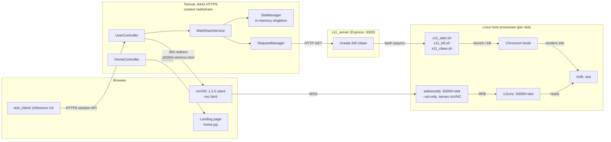
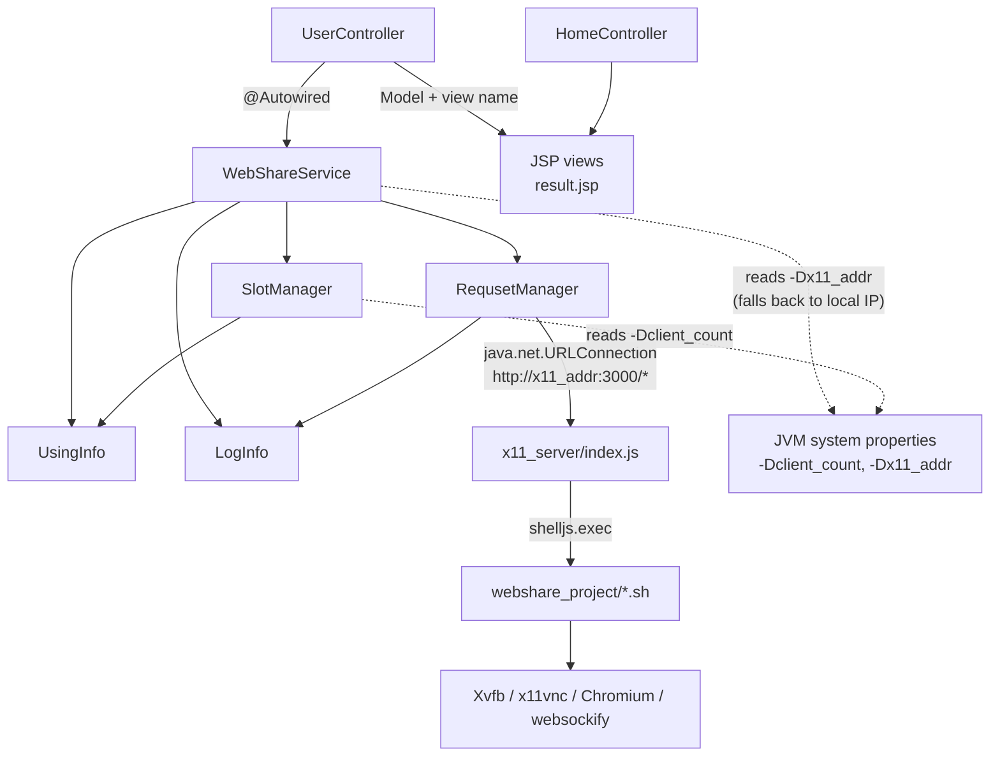

# WebShare — Architecture

WebShare gives each *channel* a dedicated remote browser. A Spring MVC WAR
allocates a slot, a Node/Express service starts Chromium inside an Xvfb
display, and users watch or control that browser through noVNC (websockify +
x11vnc). There is no database, message queue, or auth service: all allocation
state lives in memory in the Spring process.

## Architectural Style

**Layered MVC control plane + host-level process supervisor + per-slot browser
runtime.** The system is best understood as two cooperating tiers on one Linux
host:

1. **Control plane (Java/Spring MVC).** `UserController` exposes the session
   HTTP API, `WebShareService` implements the slot lifecycle, and `SlotManager`
   holds the free/used slot pool in memory. Spring is a classic
   controller → service → in-memory domain layering, wired by annotation
   (`@Controller`, `@Service`, `@Autowired`) with JSP views resolved from
   `/WEB-INF/views/`.
2. **Execution plane (Node/Express + Bash).** `webshare_project/x11_server/index.js`
   is a thin supervisor that receives `create` / `kill` / `clean` and shells out
   to the X11 scripts. The JVM never forks X11 or Chromium itself; it calls the
   supervisor over plain HTTP.

The browser is then **redirected off the Spring application** to a different
port (`https://<host>:60000+slot/vnc.html`). From that point the media path is
independent of Spring: noVNC ← WSS → websockify → RFB → x11vnc → Xvfb →
Chromium. This control/media split keeps VNC traffic out of Tomcat and lets the
Java tier stay stateless per request while the slot pool remains a process-wide
singleton.

Slots are **pre-provisioned at boot**, not created per request:
`auto_start.sh` starts N Xvfb displays, N x11vnc servers, and N websockify
processes up front. A `/create` call only launches Chromium on an already
running display. This trades fixed host resource usage for fast joins and simple
slot math: **slot index = display number**.

## System Architecture

Runtime topology and request/media paths:

Code-level dependencies inside the Spring WAR and the control service:

No database, cache, queue, or external SaaS appears in either diagram because
none exists in the code.

## Major Modules

| Module | Path | Responsibility |
|--------|------|----------------|
| Session API controller | `webshare_spring/webshare/src/main/java/com/webshare/controller/UserController.java` | HTTP routes for connect, join, disconnect, clear, status; builds log entries; redirects to noVNC |
| Home controller | `webshare_spring/webshare/src/main/java/com/webshare/controller/HomeController.java` | Renders the default `home.jsp` page with server time |
| Application service | `webshare_spring/webshare/src/main/java/com/webshare/service/WebShareService.java` | Slot lifecycle orchestration; resolves the X11 host; builds the noVNC redirect URL |
| Slot state | `webshare_spring/webshare/src/main/java/com/webshare/util/SlotManager.java` | Singleton pool: `ArrayBlockingQueue` of free slots + `ConcurrentHashMap` of channel → `UsingInfo` |
| Per-channel state | `webshare_spring/webshare/src/main/java/com/webshare/dto/UsingInfo.java` | Slot id and a participant counter for one channel |
| Control-service client | `webshare_spring/webshare/src/main/java/com/webshare/util/RequsetManager.java` | Calls `http://<x11_addr>:3000/create`, `/kill`, `/clean` via `URLConnection` |
| Logging helper | `webshare_spring/webshare/src/main/java/com/webshare/dto/LogInfo.java` | Tagged `System.out` logging enum (`Request`, `Variable`, `Error`, `Alart`) |
| Views | `webshare_spring/webshare/src/main/webapp/WEB-INF/views/` | `home.jsp`, `result.jsp` (disconnect/clear), `status.jsp` (present but unused) |
| Spring bootstrap | `webshare_spring/webshare/src/main/webapp/WEB-INF/web.xml`, `.../spring/appServlet/servlet-context.xml` | `DispatcherServlet`, annotation-driven MVC, JSP resolver, component scan of `com.webshare.{controller,service}` |
| Express control service | `webshare_project/x11_server/index.js` | `/create`, `/kill`, `/clean`; derives display from port; launches Bash asynchronously |
| Host bootstrap | `webshare_project/auto_start.sh`, `webshare_project/auto_stop.sh` | Start/stop Xvfb, uim, x11vnc, websockify, Node, Tomcat for all slots |
| Per-slot scripts | `webshare_project/x11_start.sh`, `x11_kill.sh`, `x11_clean.sh`, `noVNC_server.sh` | Resize framebuffer + launch Chromium; kill Chromium by display; kill all Xvfb and X locks; start websockify per slot |
| noVNC client | `webshare_project/noVNC/` (vendored 1.2.0, MPL-2.0) | Static VNC client served by websockify |
| Reference client | `test_client/web_share.js`, `test_client/index_api.html` | Vanilla JS wrapper over the Spring HTTP API; hard-coded sample IPs |
| Deployment config | `tomcat_need/server.xml` | Reference Tomcat connectors: 8080 HTTP, 8443 HTTPS with keystore (dev material; see gaps) |

## Layer Descriptions

### Presentation — Spring MVC controllers and JSPs

`UserController` is the entire public API surface. It maps
`/connect/{channelId}/{user}/{width}/{height}?url=`, `/connect/{channelId}/{user}`,
`/disconnect/{channelId}/{user}`, `/clear/{channelId}/{user}`, and
`/status/{channelId}/{user}`. The first two return `redirect:<noVNC URL>`;
disconnect/clear render `result.jsp`; status is `@ResponseBody` JSON
(`{"status": "free" | "using" | "busy"}`). Both controllers are annotated
`@CrossOrigin(origins = "*")`.

The controllers own no state and contain almost no logic. They translate path
variables, compute the `isControl` flag, delegate to `WebShareService`, and emit
a log line. This is why the API can be exercised by any HTTP client, including
`test_client/`.

`HomeController` only renders the landing page and is unrelated to the slot
flow.

### Application service — `WebShareService`

This is the only place that understands slot lifecycle. It:

- Resolves the X11 host from `-Dx11_addr`, falling back to
  `InetAddress.getLocalHost()`.
- On **connect**: reuses an existing channel slot, otherwise takes a free slot
  and asks `RequsetManager` to create it; increments the participant count;
  returns `https://<host>:60000+slot/vnc.html?autoconnect=true&view_only=<flag>`.
- On **disconnect**: decrements the channel's count and destroys the slot when
  it reaches zero (kill request + return the slot to the free queue).
- On **clear**: destroys immediately.
- On **status**: delegates to `SlotManager.getSlotStatus`.

It depends on the two singletons `SlotManager` and `RequsetManager`, obtained
via `getInstance()` rather than injected. That keeps the Spring container
minimal (only controller + service are scanned) at the cost of hidden global
state and harder unit testing.

### In-memory domain state — `SlotManager` and `UsingInfo`

`SlotManager` is a process-wide singleton created from
`System.getProperty("client_count")`. It holds:

- `BlockingQueue<Integer> free_slot` — `ArrayBlockingQueue` pre-filled with
  `0..N-1`.
- `ConcurrentHashMap<String, UsingInfo> using_slot` — channel id → slot.

`UsingInfo` stores the slot id and a plain `int userCount`. A channel is
considered `using` if it has an entry; the pool is `busy` when the free queue is
empty; otherwise it is `free`.

This is the system's only source of truth. It is not persisted and not shared
between Tomcat instances.

### Integration adapter — `RequsetManager`

A singleton HTTP client with no Spring dependency. It formats
`http://<server>:3000/create?port=50000+slot&url=...&width=...&height=...` and
the corresponding `/kill` URL, opens the connection, and reads the stream. It
logs the outgoing URL and swallows exceptions. `clearAllSessions()` targets
`/clean` but has no caller in the Spring code.

Keeping this adapter separate means the service layer speaks in slots and
channels; only `RequsetManager` knows the control service's URL shape and port
constants.

### Process control plane — Express + Bash

`x11_server/index.js` listens on **3000** and is deliberately tiny:

- `/create?port=&url=&width=&height=` → `bash /usr/webshare/release/x11_start.sh -p <port> -u <url> -r <width>x<height>` (async).
- `/kill?port=` → `x11_kill.sh -p <port>`.
- `/clean` → `x11_clean.sh`.

It derives `display = port - 50000` but the handlers currently ignore both
`display` and the `todo` query parameter. There is no validation, auth, or
status reporting: it responds `"finished!"` as soon as the shell command is
spawned.

The scripts keep OS-level work declarative and manually runnable:

- `x11_start.sh` resizes the framebuffer with `xrandr --fb WxH`, then launches
  Chromium in kiosk mode with `--app=http://<url>`, `--temp-profile`,
  `--no-sandbox`, an iPad user agent, and an "open link with no new tab"
  extension. It does **not** start Xvfb or x11vnc — those already exist.
- `x11_kill.sh` greps for Chromium processes whose command line matches
  `display=:<slot>` and kills them.
- `x11_clean.sh` runs `killall Xvfb` and deletes `/tmp/.X*-lock`.
- `noVNC_server.sh` starts one `websockify/run --web <noVNC> --ssl-only
  60000+i <x11_ip>:50000+i` per slot (`x11_ip` defaults to `127.0.0.1`;
  `auto_start.sh` passes the host IP instead).

### Browser media plane — noVNC, websockify, x11vnc, Xvfb, Chromium

Once redirected, the client loads static noVNC assets from websockify, opens a
WSS connection, and websockify bridges it to the per-slot x11vnc RFB port.
x11vnc shares the Xvfb display, which is where Chromium renders. Spring is no
longer in the path, so a long-lived VNC session does not consume a Tomcat
request thread or bandwidth.

### Host bootstrap — `auto_start.sh` / `auto_stop.sh`

`auto_start.sh` is the deployment entry point. It stops any previous stack,
starts `client_count` Xvfb displays (`:0..:N-1`), waits for the X lock files,
starts `uim-xim` and x11vnc on `50000+i`, starts `noVNC_server.sh`, starts the
Node service with `npm start --prefix /usr/webshare/release/x11_server`, and
finally starts Tomcat with `-Dclient_count=N -Dx11_addr=<host_ip>`.

`auto_stop.sh` is deliberately blunt: `killall -9 node`, Tomcat shutdown,
`x11_clean.sh` (kills every Xvfb), then kills every websockify process.

### Reference client — `test_client/`

Vanilla HTML/CSS/JS with no build step. `web_share.js` constructs
`https://<ip>:8443/webshare`, polls `/status/{id}/{user}` before connecting,
loads connect/disconnect/clear URLs into an `<iframe>`, and validates IP, URL,
and resolution. It is the concrete contract consumer for the HTTP API and the
best executable documentation of the intended flow.

## Ports and Slot Math

| Port / resource | Owner | Purpose |
|-----------------|-------|---------|
| `8443` | Tomcat | HTTPS connector; Spring MVC under `/webshare` |
| `8080` | Tomcat | Plain HTTP connector; `redirectPort="8443"` |
| `8005` | Tomcat | Shutdown port |
| `3000` | `x11_server/index.js` | `create` / `kill` / `clean` control API |
| `50000 + slot` | x11vnc | RFB server for one display |
| `60000 + slot` | websockify | HTTPS static noVNC + WSS→RFB bridge |
| `:0 … :N-1` | Xvfb | X displays, one per slot |

For slot `i`: display `:i`, RFB `50000+i`, noVNC `60000+i`. Spring sends
`port=50000+i` to Node; Node recovers the display by subtracting `50000`.
Capacity defaults to **50** in `auto_start.sh`, is capped at **100**, and
`SlotManager` falls back to **100** when `-Dclient_count` is absent.

## Key Dependencies

- `UserController` depends on `WebShareService` through Spring `@Autowired`;
  `servlet-context.xml` scans only `com.webshare.controller` and
  `com.webshare.service`.
- `WebShareService` depends on `SlotManager` and `RequsetManager` through
  `getInstance()` singletons, not dependency injection. This is the main reason
  the service is hard to test in isolation.
- `RequsetManager` depends on the Express contract (`/create`, `/kill`,
  `port = 50000 + slot`) and on `-Dx11_addr` for the host.
- `x11_server/index.js` depends on the deployment layout
  `/usr/webshare/release/*.sh`; the path is hard-coded.
- `noVNC_server.sh` depends on a `websockify/run` executable under
  `/usr/webshare/release/noVNC/`, plus the vendored noVNC static files.
- `test_client/` depends only on the public Spring HTTP API, not on internal
  classes.
- Both runtime tiers depend on the same host filesystem and private network;
  there is no service discovery or configuration service.

## Notable Architecture Decisions

**Control plane and media plane are split.** Spring handles allocation and
returns a redirect; VNC traffic never traverses Tomcat. This avoids proxying
video/input through the JVM and lets the Java tier remain a short-request HTTP
service.

**Slots are pre-provisioned, Chromium is lazy.** Xvfb, x11vnc, and websockify
are started for every slot at boot, while Chromium starts only when a channel
connects. This makes joins fast and slot assignment trivial, at the cost of
always-on memory/process overhead and a fixed capacity.

**One integer identifies a slot across three namespaces.** Display number, RFB
port, and noVNC port are all derived from the slot index. There is no registry;
the arithmetic is duplicated in `WebShareService`, `RequsetManager`,
`x11_server/index.js`, and the scripts, so changing the base port requires
coordinated edits.

**Node is a supervisor, not a business service.** It exists so the JVM does not
manage host processes and so Linux-specific commands stay in Bash. It holds no
state, which is why a Node restart does not disturb running browsers (but does
lose the ability to create/kill until restarted).

**State is intentionally ephemeral.** No database or session store exists.
`SlotManager` is authoritative for the lifetime of the Tomcat process.

**`user` is a role flag, not an identity.** `userType == "host"` yields
`view_only=false` (control); every other value yields `view_only=true`
(view-only). The variable is named `isControl` but is passed straight through as
`view_only`, so the naming is inverted relative to its meaning.

## Gaps and Risks

These are observable from the code and are worth knowing before changing
anything:

- **No authentication or authorization.** Every route, including
  `/clear/{channelId}/{user}`, is open; controllers use
  `@CrossOrigin(origins = "*")`; the Node control API on `:3000` has no auth
  and can start/kill processes if reachable. `user` is never verified.
- **Disconnect is channel-wide, not per-user.** `leaveSession(channelId)`
  ignores `userType` and decrements a single counter. Repeated disconnects from
  one participant can drive the count to zero and tear down a slot still used
  by others; `userCount` is also a non-atomic `int`.
- **Suspected malformed join URL.** `enterSession` builds
  `convertHostUrl(hostUrl) + "://%s:%s/vnc.html..."`, which appears to produce
  `https://host://60001/vnc.html` (double `://`). `createSession` uses the
  correct single-colon form. Not verified at runtime because the stack is
  Linux-only.
- **Fire-and-forget provisioning.** `RequsetManager` ignores HTTP status and
  swallows exceptions; `x11_server` replies before the shell finishes; and the
  shell launches Chromium in the background. Spring marks a slot used even if
  Node is down or Chromium fails, and there is no readiness handshake before
  the redirect.
- **Free-slot race.** `SlotManager.getFreeSlot()` does `peek()` then `take()`;
  if another request drains the queue between the two calls, `take()` blocks
  the request thread indefinitely.
- **Capacity can disagree with reality.** Starting Tomcat without
  `-Dclient_count` makes `SlotManager` advertise 100 slots even if
  `auto_start.sh` provisioned only 50 Xvfb/x11vnc/websockify pairs. Slots
  above the provisioned count would have no display.
- **websockify is not vendored.** `noVNC_server.sh` calls
  `noVNC/websockify/run`, but the vendored noVNC 1.2.0 tree has no
  `websockify/` directory; it must be installed on the host at that path.
- **TLS is host-provisioned.** `websockify --ssl-only` is started without an
  explicit certificate, so the TLS material depends on websockify's defaults;
  Tomcat uses the keystore referenced by `tomcat_need/server.xml` (dev
  material, git-ignored, password committed — rotate before production).
- **Exposure of VNC.** x11vnc is started with `-nopw` and without `-localhost`;
  the RFB ports should be firewalled even though the architecture treats them
  as host-local. Treat `50000+` as untrusted until the firewall is confirmed.
- **Two logging mechanisms.** `HomeController` uses SLF4J/log4j while the rest
  of the code uses the mutable-singleton `LogInfo` enum writing to
  `System.out`; concurrent requests can interleave the shared `message` field.
- **No tests, no CI.** `pom.xml` declares JUnit but there are zero test
  classes; `mvn test` passes without exercising anything. The shell scripts are
  destructive host-level operations and cannot run on macOS as-is.
- **Legacy platform.** Spring 4.3.1, Servlet 2.5, Java 6 compiler target, and a
  Spring 4-era JSP setup; plan upgrades separately from feature work.
- **Dead or unused pieces.** `clearAllSessions()`/`/clean` have no Spring
  caller, `status.jsp` is not referenced by a controller return value, and
  `todo`/`display` in the Node `extract()` result are unused.
