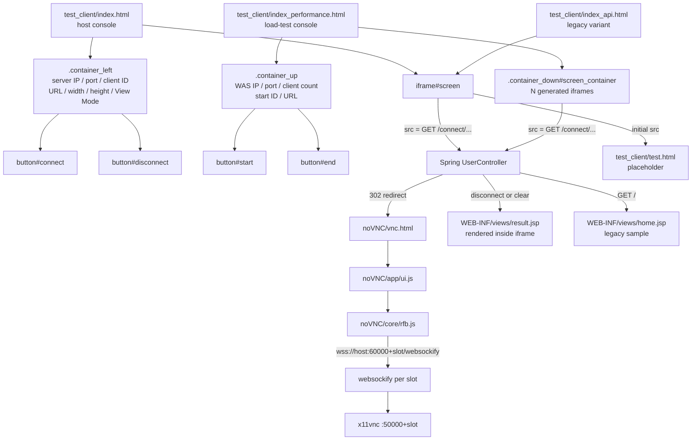
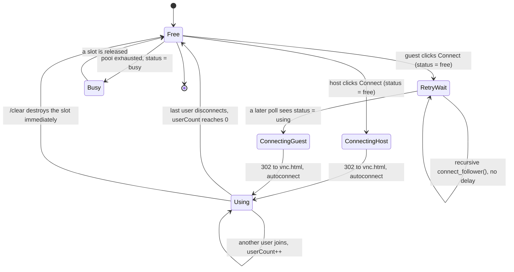
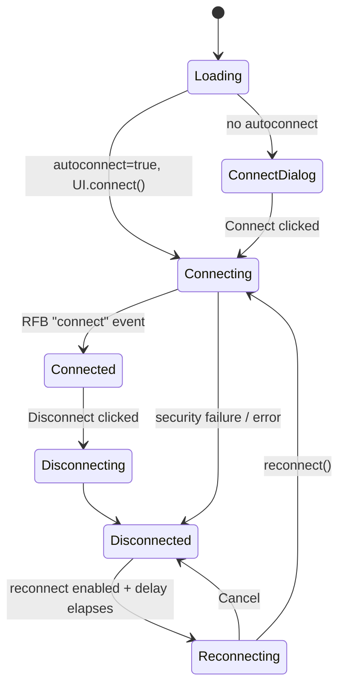

# WebShare — UI Components

WebShare has no SPA framework. The UI is three layers:

1. **Static test harness** in `test_client/` — plain HTML + classic browser JS
   (ES2015 classes), no build step, no router.
2. **Server-rendered JSP** in `webshare_spring/webshare/src/main/webapp/WEB-INF/views/`
   — acknowledgement pages rendered by Spring MVC.
3. **Vendored noVNC 1.2.0** in `webshare_project/noVNC/` — the actual remote
   browser viewer. Third-party (MPL-2.0), customized in place.

The harness does not use client-side routing at all. "Navigation" means
assigning `iframe.src` to a Spring endpoint, which 302-redirects to
`vnc.html`. Every screen transition is a full document load inside that
iframe.

## Tech Stack

| Concern | Solution |
|---|---|
| Framework | None. Static HTML5 + browser JS (`class web_share` in `test_client/web_share.js`); JSP (JSTL taglib) for Spring result pages |
| Build / bundler | None. Files are served as-is; no `package.json` in `test_client/` |
| Routing | No router. `iframe.src` navigation to Spring URLs, then HTTP 302 to noVNC |
| Global state | None. Per-instance fields on `web_share`; per-page module-level variables |
| Server state | `fetch()` to Spring `/webshare/status/...`; no cache, no query library |
| Forms | Plain DOM inputs read inside button `onclick` handlers; validation by regex in `web_share.exceptionCheck()` and `alert()` |
| Styling | Plain CSS, one file per harness page, BEM-ish class names, no design tokens |
| Remote viewer | noVNC 1.2.0 (`vnc.html`, `app/ui.js`, `core/rfb.js`, ES modules) |
| Icons / fonts | Inline SVG assets from noVNC `app/images/`; system fonts only |
| RSC / `'use client'` | Not applicable |

## Component Hierarchy



There are no layout providers, contexts, or shared component library. The only
reusable units are the `web_share` class and the CSS blocks listed under
[Shared UI Blocks](#shared-ui-blocks).

## Navigation ("Route") Structure

| Navigation | Triggered by | URL | Renders |
|---|---|---|---|
| Harness load | Developer opens the page directly or via a static server | `test_client/index.html`, `index_api.html`, `index_performance.html` | Form panel + iframe(s) |
| Placeholder | Initial `iframe#screen` | `test_client/test.html` | Static "TEST IFRAME" page |
| Create session (host) | `Connect` (leader path) | `https://{server_ip}:8443/webshare/connect/{channel}/{user}/{width}/{height}?url={url}` | `UserController.createSession()` → 302 to `vnc.html` |
| Join session | `Connect` with `connect_follower()` | `https://{server_ip}:8443/webshare/connect/{channel}/{user}` | `UserController.enterSession()` → 302 to `vnc.html` |
| Disconnect | `Disconnect` (`web_share.disconnect`) | `.../webshare/disconnect/{channel}/{user}` | `WEB-INF/views/result.jsp` with `${type}` = `disconnect` |
| Clear (immediate destroy) | `web_share.clear()` (no UI button calls it) | `.../webshare/clear/{channel}/{user}` | `result.jsp` with `${type}` = `clear` |
| Status poll | `web_share.status()` | `.../webshare/status/{channel}/{user}` | JSON `{"status":"free"\|"using"\|"busy"}` via `@ResponseBody` |
| Viewer | Spring 302 | `https://{x11_host}:{60000 + slot}/vnc.html?autoconnect=true&view_only={bool}` | noVNC viewer |
| Home | Manual | `/webshare/` | `home.jsp` (Spring sample, not part of the product flow) |

Notes:

- The client always builds `https://{ip}:8443/webshare` — `SERVER_PORT` is a
  constant in `test_client/web_share.js`. The **Server Port input is captured
  but ignored**.
- `result.jsp` (`<h1>${type} success!</h1>`) is loaded *inside the iframe*. After
  a disconnect the viewer is replaced by this acknowledgment page; there is no
  navigation back to `test.html` or the harness panel.
- `status.jsp` exists but is unreachable: `sessionStatus()` returns a
  `HashMap` with `@ResponseBody`, and the JSP-rendering branch is commented out.
- `enterSession()` builds its redirect with
  `convertHostUrl(hostUrl) + "://%s:%s/vnc.html..."`, producing a doubled
  scheme (`https://host://60000/vnc.html...`). The create path in
  `createSession()` is the known-good URL shape.
- The `user` path segment is not an auth identity. Literal `host` means
  control; anything else means view-only (see
  [Host / Guest Semantics](#host--guest-semantics-view_only)).

## State Management

There is no store, no context, and no event bus.

### Client state

| Location | State | Lifetime |
|---|---|---|
| `test_client/web_share.js` | `ip`, `id` (channel), `user_type`, `base_url` | One instance per session |
| `test_client/script.js` | `api` (single `web_share` instance), `temp_server_ip`, `temp_port`, `temp_client_id` (written, never read) | Page lifetime |
| `test_client/script_api.js` | `const api` created at script load with a hard-coded IP | Page lifetime |
| `test_client/script_performance.js` | `apis` array, one instance per generated iframe; `temp_*` copies | Page lifetime |
| DOM | `button.disabled` on Connect/Disconnect (or Start/End) | Drives the visible "connected" impression |

The server owns the real session state in the `SlotManager` singleton
(`free_slot` queue + `using_slot` map). The UI only samples it through
`GET /status/{channel}/{user}` and never caches the result.

### Polling / retry behavior

- **Leader**: `connect_leader()` validates inputs, calls `status()`, and
  proceeds only when the result is exactly `free`. If the channel is already
  `using` or the pool is `busy`, it silently does nothing.
- **Follower**: `connect_follower()` retries until the channel reports `using`.
  On `free` it calls itself again **immediately, with no delay or backoff**
  (`web_share.js` lines 54-56) — an unbounded promise chain while the host has
  not created the slot. On `busy` it gives up.
- `script.js` disables Connect / enables Disconnect as soon as
  `connect_leader()` returns `true`, i.e. after validation but *before* the
  asynchronous status check and redirect. A failed or `busy` status therefore
  leaves the buttons in the "connected" arrangement with no viewer.
- `disconnect_now()` and `clear_now()` use `fetch()` instead of the iframe and
  are not called by any page.

## Connection Lifecycle State Machine

Two independent state machines are involved: the **slot lifecycle** enforced by
Spring/`SlotManager`, and the **VNC transport lifecycle** inside noVNC.

### Slot lifecycle (visible through `/status`)



`SlotManager.getSlotStatus()` returns:

- `free` — no slot assigned to this channel **and** at least one free slot.
- `using` — channel has a slot; joiners are allowed.
- `busy` — no slot for this channel and the free queue is empty; creation and
  joining are both refused.

The host is whoever calls `/connect/{channel}/host/{w}/{h}?url=` first. Any
later `/connect/{channel}/{user}` joins the existing slot. The `UsingInfo`
user count is incremented per call and the slot is destroyed at zero
(`disconnect`) or immediately (`clear`).

### VNC transport lifecycle (inside noVNC)



These are expressed as `:root` CSS classes managed by
`UI.updateVisualState()` in `webshare_project/noVNC/app/ui.js`:
`noVNC_loading`, `noVNC_connecting`, `noVNC_connected`, `noVNC_disconnecting`,
`noVNC_reconnecting`. Reconnect is initialized to `false`
(`initSetting('reconnect', false)`), so the default deployment path goes
straight to `disconnected`.

## First-Party Screens and Scripts

| File | Role |
|---|---|
| `test_client/index.html` | Host console. Server IP, port, client ID, URL, width, height, "View Mode" checkbox, Connect/Disconnect buttons, `iframe#screen` |
| `test_client/script.js` | Reads the form, rejects empty fields, constructs `new web_share(ip, client_id, 'host')`, calls `connect_leader()`; Disconnect calls `api.disconnect(screen)`. The `view_mode` checkbox is never read |
| `test_client/index_api.html` | Older trimmed console: URL, width, height, "Guest" checkbox, Connect/Disconnect |
| `test_client/script_api.js` | Stale API usage: calls `connect_leader()` / `connect_follower()` with no `screen`, and constructs `web_share` with five arguments against a three-argument constructor. Validates against the wrong iframe and does not work against the current class |
| `test_client/index_performance.html` | Load-test console: WAS IP, port, client count, start ID, URL, Start/End, empty `#screen_container` grid |
| `test_client/script_performance.js` | Clears the grid, generates `client_count` iframes, creates one `web_share` per iframe with channel `screen_{i + start_id}`, connects each to `www.youtube.com` sized to the container. End calls `api.disconnect()` without a `screen` argument |
| `test_client/web_share.js` | The client SDK used by all pages: `connect_leader`, `connect_follower`, `disconnect`, `disconnect_now`, `clear`, `clear_now`, `status`; private `check_server_leader`, `check_server_follewer`, `connect_url`, `exception_check`. Hard-codes port 8443 and resolution bounds 0–1920 |
| `test_client/webshare.js` | Unreferenced camelCase duplicate of `web_share.js`; no HTML loads it. Historical draft |
| `test_client/test.html` | Placeholder shown in the iframe before any connection |
| `test_client/style.css` | 40 / 60 horizontal flex split for `index.html` and `index_api.html` |
| `test_client/style_performance.css` | 15 / 85 vertical stack with a wrapping iframe grid |
| `webshare_spring/.../WEB-INF/views/home.jsp` | Spring sample page: server time, plus iframe/embed of external sites. Not part of the product flow |
| `webshare_spring/.../WEB-INF/views/result.jsp` | `<h1>${type} success!</h1>` acknowledgment for `disconnect` and `clear`; displayed inside the iframe |
| `webshare_spring/.../WEB-INF/views/status.jsp` | `<h1>Status : ${status}</h1>`; currently unreachable because the status endpoint returns JSON |

Validation in `web_share.exceptionCheck()` runs before any request:

- IP must match an IPv4 regex.
- `screen` must be an `IFRAME` element.
- Leader URLs must contain a dotted hostname (with or without scheme).
- Width/height must be within `MIN_*`/`MAX_*` (0–1920 as configured).

Failures are reported with `alert()` and the method returns `false`.

## Host / Guest Semantics (`view_only`)

The only identity signal is the `{user}` path segment:

```java
// UserController.java
boolean isControl = userType.equals("host") ? false : true;
// ...
".../vnc.html?autoconnect=true&view_only=%b", isControl
```

The variable name is inverted — `isControl` actually means *view only*.

| `{user}` value | `view_only` query value | noVNC behavior |
|---|---|---|
| `host` | `false` | Control bar is opened; mouse/keyboard events are forwarded; back/forward/refresh, power, clipboard, settings and fullscreen controls are available |
| Anything else (`guest`, a name, an ID) | `true` | Control bar is never opened and its handle is hidden after connect; `RFB.viewOnly` skips mouse and keyboard events; input is display-only |

`view_only` is read from the query string via `WebUtil.getConfigVar` and
applied in `UI.updateViewOnly()` → `UI.rfb.viewOnly`. It is also exposed as a
"View Only" checkbox in the noVNC settings panel, so a host can toggle it at
runtime (the guest's control bar is hidden, but the setting still exists).

The harness only ever connects as `host`: `script.js` hard-codes it, and
`index_api.html` also constructs the instance with `'host'` despite showing a
"Guest" checkbox. Joining as a view-only guest is possible through the URL, but
no current harness page does it.

## noVNC Integration Surface

Treat `webshare_project/noVNC/` as third-party (MPL-2.0). Only the integration
points below matter for WebShare work.

| Integration point | Detail |
|---|---|
| Viewer entry | `webshare_project/noVNC/vnc.html`, served by websockify (`noVNC_server.sh` runs `websockify/run --web {noVNC} --ssl-only {60000+slot} {x11_ip}:{50000+slot}`) |
| Query parameters | `autoconnect=true` (auto-calls `UI.connect()`), `view_only={true\|false}` |
| WebSocket target | Derived from `window.location`, not from query params: `wss://{vnc host}:{60000+slot}/websockify` because the page is HTTPS and the default path setting is `websockify` |
| View-only effect | `core/rfb.js` checks `_viewOnly` before sending pointer/key events and before remote resize |
| Control bar | `#noVNC_control_bar` inside `vnc.html`; opened by `ui.js` only when `view_only` is false |
| Custom controls | Back (`Alt+Left`), Forward (`Alt+Right`), Refresh (`F5`) image buttons bound in `UI.addCustomHandlers()`; send key sequences to the remote browser via `UI.sendKeys()` |
| Connection feedback | `#noVNC_status` banner (`noVNC_open`, `noVNC_status_normal` / `_warn` / `_error`) and the `#noVNC_transition` overlay with spinner and Cancel button |
| Connect dialog | `#noVNC_connect_dlg` — only shown when `autoconnect` is absent, i.e. not on the normal redirected path |
| Render target | `#noVNC_container` (canvas), plus `#noVNC_keyboardinput` textarea for soft keyboards |
| Local customizations | Korean comments, title `webshare`, logo replaced by "Webshare", logging selector, `scaleViewport = true`, `qualityLevel = 3`, `compressionLevel = 0`, control bar initially disabled in `UI.init()` |
| Locales | `app/locale/*.json`; upstream translation mechanism |
| Styling | `app/styles/base.css` (no CSS custom properties); state handled by `:root.noVNC_*` classes and `.noVNC_hidden` |

Do not describe or edit upstream files unless the task is specifically about
viewer behavior; WebShare's own UI ends at the iframe boundary.

## Shared UI Blocks

| Block | Path | Purpose |
|---|---|---|
| `web_share` class | `test_client/web_share.js` | Shared client for connect / join / status / disconnect / clear |
| `.container_left`, `.container_left__input` | `test_client/style.css` | Yellow left form column used by `index.html` and `index_api.html` |
| `.container_right`, `#screen` | `test_client/style.css` | Viewer column / iframe filling the right 60% |
| `.container_up`, `.container_up__box`, `.container_up__input` | `test_client/style_performance.css` | Top control strip of the load-test page |
| `.container_down`, `#screen_container` | `test_client/style_performance.css` | Wrapping grid of generated iframes |
| `.container_center` | `test_client/style.css` | Centering wrapper used by `test.html` and the placeholder content |
| `result.jsp` | `webshare_spring/.../WEB-INF/views/result.jsp` | Generic success acknowledgment inside the iframe |

## Styling Conventions

- **Methodology:** plain CSS, one stylesheet per harness page. No Tailwind, CSS
  Modules, Sass, or CSS-in-JS. No build step.
- **Naming:** BEM-like block/element names with double underscores
  (`container_left__input`, `container_up__box`). No modifiers (`--*`) are used.
  IDs are reserved for JS hooks (`#connect`, `#screen`, `#screen_container`).
- **Layout:** flexbox only. `index.html` uses a 40% / 60% row; the performance
  page uses a 15% / 85% column with `flex-wrap: wrap` for the iframe grid.
  Iframes are sized in percentages (`100%`, or `9.5%` × `20%` in the grid).
- **Tokens:** none. The accent color `#fce309` is duplicated literally in
  `style.css` and `style_performance.css`; there are no CSS variables, theme
  file, or spacing scale.
- **Responsive behavior:** no media queries or breakpoints. The layout scales
  only because dimensions are percentages; small viewports compress the form
  and buttons rather than reflowing.
- **Controls:** buttons size themselves relative to the parent
  (`width: 30%; height: 5%` on the host console, `10% / 20%` on the load-test
  console), so appearance depends on container size. Inputs use browser
  defaults with a small margin.
- **Markup quirks:** labels use `for=` to wrap inputs, but some `for` values do
  not match the input `id` (e.g. `for="client_id"` pointing at
  `id="client_count"`). The noVNC stylesheet is independent and uses
  `.noVNC_*` classes plus state classes on `<html>`.

## Known Rough Edges (UI-relevant)

| Issue | Location | Effect |
|---|---|---|
| Port input ignored | `test_client/script.js`, `web_share.js` | `SERVER_PORT = 8443` always wins |
| "View Mode" checkbox unused | `test_client/index.html` | No way to connect as guest from this page |
| Stale API usage | `test_client/script_api.js` | Calls methods without `screen`; warns "wrong screen(iframe) element!" |
| Load-test End broken | `test_client/script_performance.js` | `api.disconnect()` is called without an iframe, so `screen.src` throws and the loop aborts |
| Retry loop has no delay | `test_client/web_share.js` (`connect_follower`) | Guest hammers `/status` while waiting for a host |
| Buttons update optimistically | `test_client/script.js` | Connect is disabled before the status check resolves; a `busy`/`using` result leaves the UI stuck |
| `status.jsp` dead | `WEB-INF/views/status.jsp` | Status is JSON; the JSP branch is commented out |
| `webshare.js` unused duplicate | `test_client/webshare.js` | Not referenced by any page; edit `web_share.js` instead |
| Join redirect URL malformed | `WebShareService.enterSession()` | Duplicated `://` when appending the noVNC port |
| Result page traps the iframe | `WEB-INF/views/result.jsp` | After Disconnect the iframe shows only "disconnect success!"; the harness must reconnect |
