# WebShare — Data Flows

WebShare allocates one remote-browser slot per channel and lets users watch or control that browser through noVNC. This document traces every HTTP endpoint, control-service call, X11 lifecycle script, and browser/noVNC connection path in the repository.

There is **no authentication, authorization, database, message queue, cron job, or webhook**. All state lives in JVM memory (`SlotManager`) and in host processes (Xvfb, x11vnc, websockify, Chromium). The flows below are the complete runtime surface.

## Flow Index

| Flow | Category | Files Involved |
|------|----------|---------------|
| [Home Page](#home-page) | UI | `HomeController.java`, `home.jsp`, `servlet-context.xml` |
| [Create Session](#create-session) | Session / API | `UserController.java`, `WebShareService.java`, `SlotManager.java`, `RequsetManager.java` |
| [Join Session](#join-session) | Session / API | `UserController.java`, `WebShareService.java`, `SlotManager.java`, `UsingInfo.java` |
| [Disconnect Session](#disconnect-session) | Session / API | `UserController.java`, `WebShareService.java`, `SlotManager.java`, `RequsetManager.java` |
| [Clear Session](#clear-session) | Session / API | `UserController.java`, `WebShareService.java`, `SlotManager.java`, `RequsetManager.java` |
| [Session Status](#session-status) | API | `UserController.java`, `WebShareService.java`, `SlotManager.java` |
| [Node Control Dispatch](#node-control-dispatch) | Internal API | `webshare_project/x11_server/index.js` |
| [X11 Slot Start](#x11-slot-start) | Process lifecycle | `index.js`, `x11_start.sh` |
| [X11 Slot Kill](#x11-slot-kill) | Process lifecycle | `index.js`, `x11_kill.sh` |
| [X11 Global Clean](#x11-global-clean) | Process lifecycle | `index.js`, `x11_clean.sh`, `auto_stop.sh` |
| [Host Auto Start](#host-auto-start) | Host operations | `auto_start.sh`, `noVNC_server.sh`, `auto_stop.sh` |
| [Host Auto Stop](#host-auto-stop) | Host operations | `auto_stop.sh`, `x11_clean.sh` |
| [noVNC Server Provisioning](#novnc-server-provisioning) | Infrastructure | `noVNC_server.sh`, `noVNC/websockify/run` |
| [Browser Client Connect](#browser-client-connect) | Client | `test_client/index.html`, `script.js`, `web_share.js` |
| [noVNC Screen Stream](#novnc-screen-stream) | Client / streaming | `noVNC/vnc.html`, `noVNC/app/ui.js`, `noVNC/core/rfb.js`, websockify, x11vnc |

## Runtime Surface

### Spring MVC HTTP endpoints

Context path: `/webshare`. All handlers are annotated `@CrossOrigin(origins = "*")`; none check credentials.

| Method | Path | Handler | Response |
|--------|------|---------|----------|
| GET | `/` | `HomeController.home` | `home.jsp` |
| GET | `/connect/{channelId}/{user}/{width}/{height}?url=` | `UserController.createSession` | `302` redirect to noVNC, or redirect containing `NO URL BECAUSE OF ERROR` |
| GET | `/connect/{channelId}/{user}` | `UserController.enterSession` | `302` redirect to noVNC, or the error redirect |
| GET | `/disconnect/{channelId}/{user}` | `UserController.leaveSession` | `result.jsp` (`disconnect success!`) |
| GET | `/clear/{channelId}/{user}` | `UserController.clearSession` | `result.jsp` (`clear success!`) |
| GET | `/status/{channelId}/{user}` | `UserController.sessionStatus` | JSON `{"status":"free" \| "using" \| "busy"}` |

`/resources/**` is served as static content by the Spring resource handler. Every state-changing endpoint is a **GET** and the reference client invokes several of them by navigating an iframe, so refreshes and history navigation repeat the side effect.

### Node control-service endpoints

The Express service listens on port `3000`. It binds all interfaces and has no authentication. Every handler returns the text `finished!` immediately; the shell work happens asynchronously.

| Method | Path | Query parameters | Shell command |
|--------|------|------------------|---------------|
| GET | `/create` | `port`, `url`, `width`, `height` | `x11_start.sh -p port -u url -r widthxheight` |
| GET | `/kill` | `port` | `x11_kill.sh -p port` |
| GET | `/clean` | none used | `x11_clean.sh` |

The Java code only calls `/create` and `/kill`. `RequsetManager.clearAllSessions` (which would call `/clean`) exists but has no caller.

### Port map

| Component | Port | Owner |
|-----------|------|-------|
| Tomcat / Spring MVC | `8443` HTTPS | host deployment |
| Node control service | `3000` | `x11_server/index.js` |
| x11vnc, per slot | `50000 + slot` | `auto_start.sh` |
| websockify + noVNC, per slot | `60000 + slot` | `noVNC_server.sh` |
| Xvfb display, per slot | `:slot` (`:0` … `:N-1`) | `auto_start.sh` |

---

## Home Page

A browser opening the application root receives a static JSP with the server time and two embedded third-party pages.

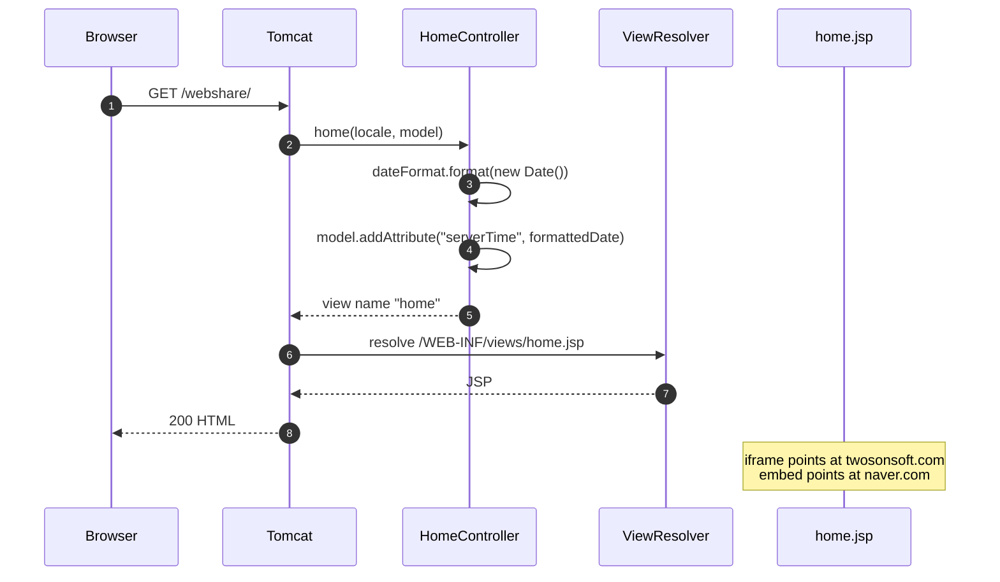

**Key files:**
- `webshare_spring/webshare/src/main/java/com/webshare/controller/HomeController.java` — handler
- `webshare_spring/webshare/src/main/webapp/WEB-INF/views/home.jsp` — view
- `webshare_spring/webshare/src/main/webapp/WEB-INF/spring/appServlet/servlet-context.xml` — component scan and JSP view resolver

**Notes:** No slot is touched and no session is created. The embedded URLs are leftovers from a demo and are unrelated to the browser-sharing flow.

---

## Create Session

A client calls the full connect endpoint to start (or re-enter) a channel; Spring allocates a free slot if needed, asks the Node service to launch Chromium on that slot's X display, increments the user count, and redirects the browser to the slot's noVNC URL.

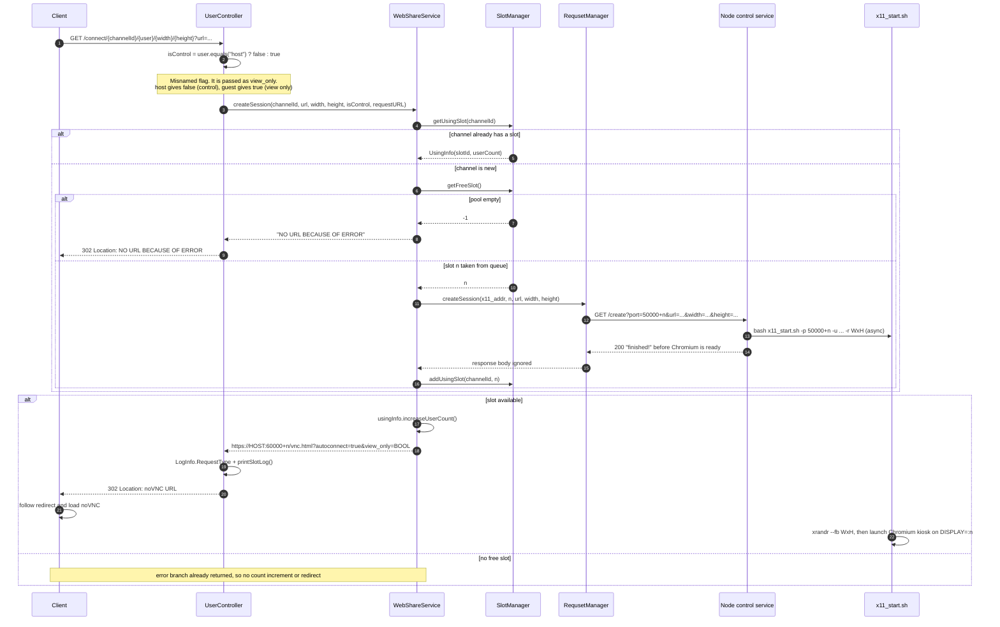

**Key files:**
- `webshare_spring/webshare/src/main/java/com/webshare/controller/UserController.java` — path variables, host/guest inversion, redirect
- `webshare_spring/webshare/src/main/java/com/webshare/service/WebShareService.java` — slot lookup, URL construction
- `webshare_spring/webshare/src/main/java/com/webshare/util/SlotManager.java` — free-slot queue and channel map
- `webshare_spring/webshare/src/main/java/com/webshare/util/RequsetManager.java` — HTTP call to Node
- `webshare_spring/webshare/src/main/java/com/webshare/dto/UsingInfo.java` — slot id + user count
- `webshare_project/x11_server/index.js`, `webshare_project/x11_start.sh` — slot process launch

**Notes:**
- The `clientURL` is built from `request.getRequestURL()`, not from configuration. `convertHostUrl` splits on `:` and keeps only scheme + `//host`, dropping Tomcat's port and the `/webshare` context path. The returned URL mirrors the request scheme, so an HTTP request yields an HTTP noVNC page even though websockify runs `--ssl-only`.
- The start URL is concatenated into the Node query string without URL encoding, and Node concatenates it into a shell command without quoting. A `&` truncates the query; shell metacharacters can execute arbitrary commands as the Node user.
- If the channel already exists, the supplied `url`, `width`, and `height` are ignored. The caller simply joins the existing browser, but its own `user` value still determines the `view_only` query flag.
- Node responds before `x11_start.sh` finishes, and `x11_start.sh` does not wait for Chromium. The user is redirected while the browser is still starting.
- There is a check-then-act race: two concurrent first requests for the same new channel can both take a slot, both create Chromium, and both call `addUsingSlot`; the second map write overwrites the first, leaking one slot and one Chromium process. `UsingInfo.userCount` is also not synchronized.
- If `getFreeSlot` returns `-1`, the controller still returns `"redirect:NO URL BECAUSE OF ERROR"`. There is no error page and no HTTP error status.
- `x11_addr` comes from the `-Dx11_addr` system property, falling back to `InetAddress.getLocalHost().getHostAddress()`. Both the Node `/create` call and the websockify-to-x11vnc proxy depend on that address being reachable. Loopback, container, or multi-homed addresses can make allocation succeed while Chromium launch or the VNC proxy fails.

---

## Join Session

A second user joins an existing channel by calling the short connect endpoint; Spring reuses the channel's slot, increments its refcount, and redirects the user to the same noVNC port with a view-only or control flag.

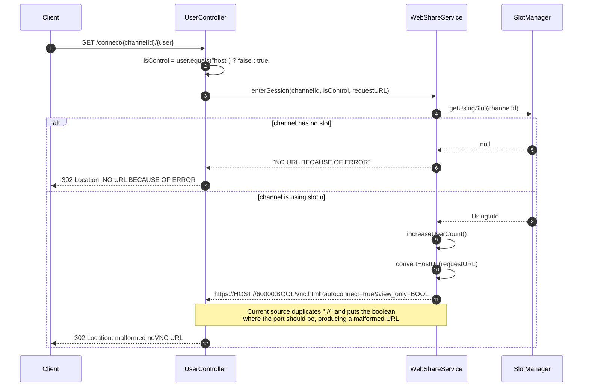

**Key files:**
- `webshare_spring/webshare/src/main/java/com/webshare/controller/UserController.java` — short connect mapping
- `webshare_spring/webshare/src/main/java/com/webshare/service/WebShareService.java` — `enterSession`, including the malformed format string
- `webshare_spring/webshare/src/main/java/com/webshare/util/SlotManager.java` — channel lookup
- `webshare_spring/webshare/src/main/java/com/webshare/dto/UsingInfo.java` — refcount increment

**Notes:**
- **Known bug:** `enterSession` returns `convertHostUrl(hostUrl) + "://%s:%s/vnc.html?..."` with `(NOVNC_PORT + slotId)` and `isControl` as arguments. Because `convertHostUrl` already returns `https://host`, the result looks like `https://host://60000:true/vnc.html?autoconnect=true&view_only=true`. The redirect is not a valid noVNC URL. `createSession` uses the correct one-colon format.
- Joining does not pass a URL, resolution, or slot choice. All users of a channel share one Chromium tab.
- The `user` path segment is the only thing that controls `view_only`, and it is entirely caller-supplied. `host` means control; anything else means view-only.
- The refcount is per **connect call**, not per distinct user. Reloading the connect endpoint increments it again; closing a tab never decrements it.
- `convertHostUrl(hostUrl);` is called once and discarded before the format call. It has no side effect.

---

## Disconnect Session

A user releases their connection to a channel; Spring decrements the channel's user count and, when it reaches zero, asks Node to kill the slot's Chromium and returns the slot to the free pool.

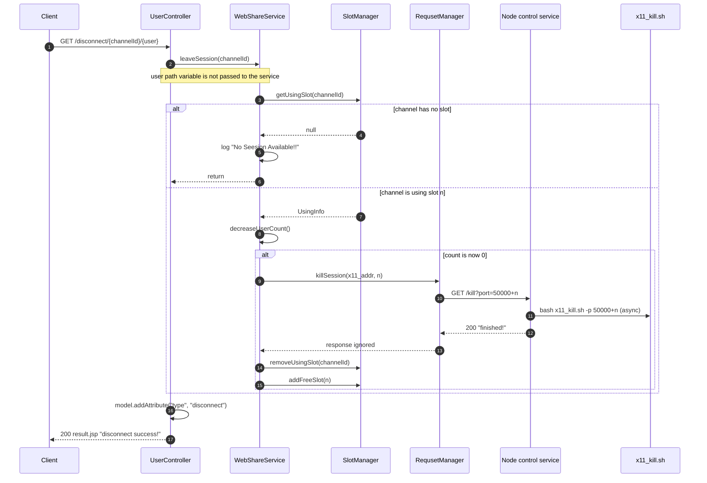

**Key files:**
- `webshare_spring/webshare/src/main/java/com/webshare/controller/UserController.java` — `leaveSession`
- `webshare_spring/webshare/src/main/java/com/webshare/service/WebShareService.java` — `leaveSession`, `destorySlot`
- `webshare_spring/webshare/src/main/java/com/webshare/util/SlotManager.java` — `removeUsingSlot`, `addFreeSlot`
- `webshare_spring/webshare/src/main/java/com/webshare/util/RequsetManager.java` — `/kill` call
- `webshare_project/x11_server/index.js`, `webshare_project/x11_kill.sh` — process teardown

**Notes:**
- The `user` value is logged only. Disconnecting any caller decrements the channel's single counter, so one viewer can call disconnect twice and destroy a session that other viewers are still using.
- A count that never reaches zero keeps the slot allocated forever. Conversely, concurrent non-atomic decrements (or a disconnect racing a clear) can destroy early, kill twice, and enqueue the same slot twice, after which two channels can be assigned the same display.
- There is no disconnect on tab close, page unload, or noVNC disconnect. Abandoned sessions stay in `using_slot` until someone calls `/disconnect` enough times or `/clear`.
- The slot is freed immediately after Node returns, while `x11_kill.sh` is still running asynchronously. A new create can reuse the display before the old Chromium has exited.
- The client exposes both iframe navigation (`disconnect`) and a `fetch` variant (`disconnect_now`); both issue the same plain GET, so there is no difference in server behavior.
- The response is always `200` with a success JSP, even when the channel did not exist or the user count made no transition.

---

## Clear Session

A caller destroys a channel's slot immediately, regardless of how many users are connected.

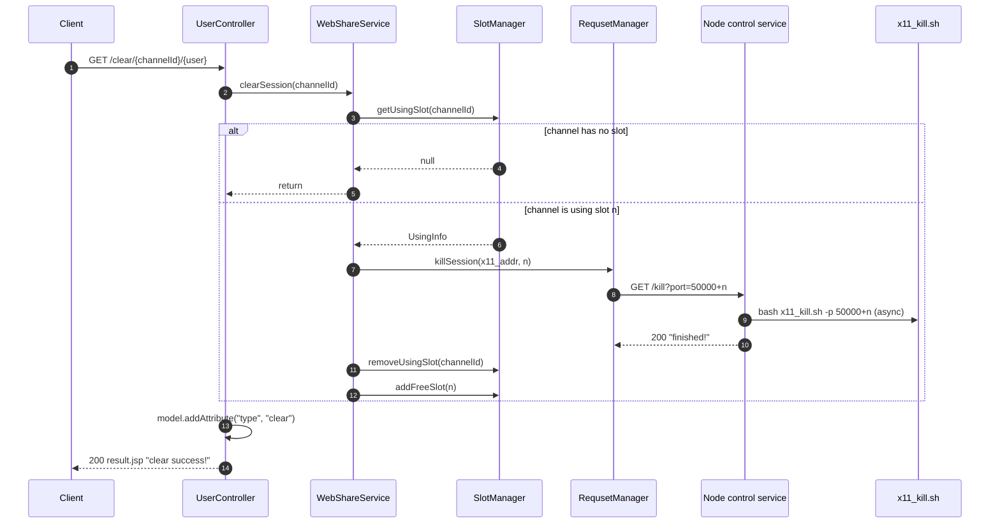

**Key files:**
- `webshare_spring/webshare/src/main/java/com/webshare/controller/UserController.java` — `clearSession`
- `webshare_spring/webshare/src/main/java/com/webshare/service/WebShareService.java` — `clearSession`, `destorySlot`
- `webshare_spring/webshare/src/main/java/com/webshare/util/SlotManager.java` — map/queue mutation
- `webshare_project/x11_kill.sh` — kills Chromium on the display

**Notes:**
- `clear` ignores the user count: all connected viewers lose their browser at once.
- The `user` value is again ignored. Any caller who knows a channel id can clear it.
- Clearing an unknown channel is a silent no-op but still renders `clear success!`.
- Only Chromium is killed. Xvfb and x11vnc remain running for the slot, ready for the next create. That is why a cleared slot can be reused quickly.
- There is no Spring endpoint that calls Node's `/clean`; `clearSession` is per channel, not per host.

---

## Session Status

The reference client checks this endpoint before creating or joining a session. It reports whether the caller's channel already has a slot, or whether a new one could be allocated.

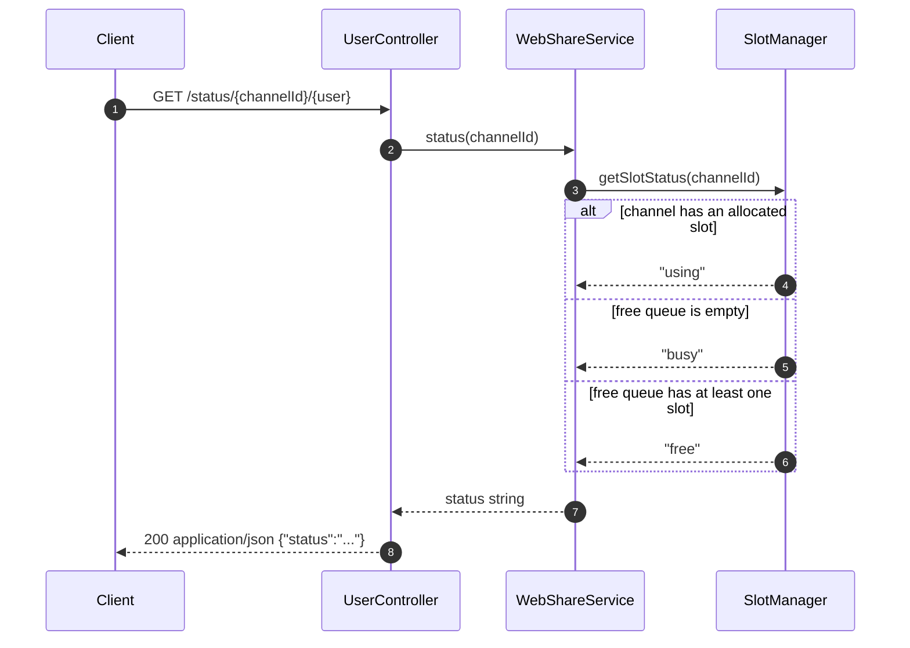

**Key files:**
- `webshare_spring/webshare/src/main/java/com/webshare/controller/UserController.java` — `@ResponseBody` HashMap
- `webshare_spring/webshare/src/main/java/com/webshare/service/WebShareService.java` — delegates to slot manager
- `webshare_spring/webshare/src/main/java/com/webshare/util/SlotManager.java` — three-state decision
- `webshare_spring/webshare/src/main/webapp/WEB-INF/views/status.jsp` — unused; `@ResponseBody` bypasses view resolution
- `webshare_spring/webshare/pom.xml` — Jackson `jackson-databind` provides JSON serialization

**Notes:**
- `using` takes precedence even when the free pool is empty. `busy` is returned only for a channel that has no slot while the pool is empty.
- `free` means "this channel has no slot and at least one slot is available", not "the channel exists". A leader uses `free` as permission to create.
- `free_slot.isEmpty()` is checked separately from allocation. Status can say `free` and the subsequent `getFreeSlot` can still lose the race to another request.
- There is no per-user state; the `user` path variable is ignored.

---

## Node Control Dispatch

The Node/Express control service receives internal HTTP requests from Spring and turns them into asynchronous shell commands.

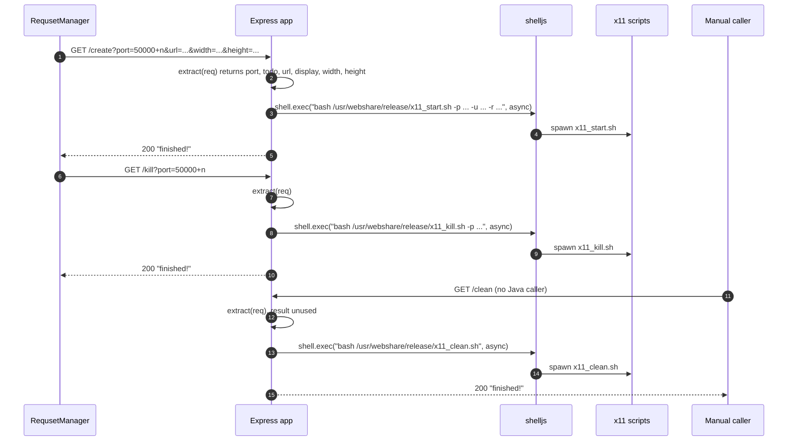

**Key files:**
- `webshare_project/x11_server/index.js` — all three routes, `extract`, `run`, `kill`, `clean`
- `webshare_project/x11_server/package.json` — Express and shelljs dependencies
- `webshare_spring/webshare/src/main/java/com/webshare/util/RequsetManager.java` — only Java caller (`/create`, `/kill`)

**Notes:**
- `webshare_dir` is hard-coded to `/usr/webshare/release`. Running the service from this checkout will invoke paths that do not exist unless the deployment layout matches.
- The service performs no validation of `port`, `url`, `width`, or `height`, and does not inspect the exit code of the spawned shell. It always answers `200 finished!`.
- `extract` computes `display = port - 50000`, but `/kill` passes only `port` to `x11_kill.sh`, which recomputes the display itself. `/clean` ignores all extracted values.
- `shell.exec` is called with `async: true`; the HTTP response is sent before the shell starts or finishes. There is no queue, retry, or concurrency limit.
- The commands interpolate user-controlled query values directly into a shell string. This is a command-injection surface, not just a quoting bug.
- `app.listen(PORT)` binds all interfaces; there is no auth or IP allowlist. Anyone who can reach `:3000` can create, kill, or globally clean slots.
- The service has no `/health` endpoint and no logging beyond `console.log("get")`.

---

## X11 Slot Start

Node invokes `x11_start.sh` for a slot; the script resizes the slot's X framebuffer and launches a Chromium kiosk window on that display.

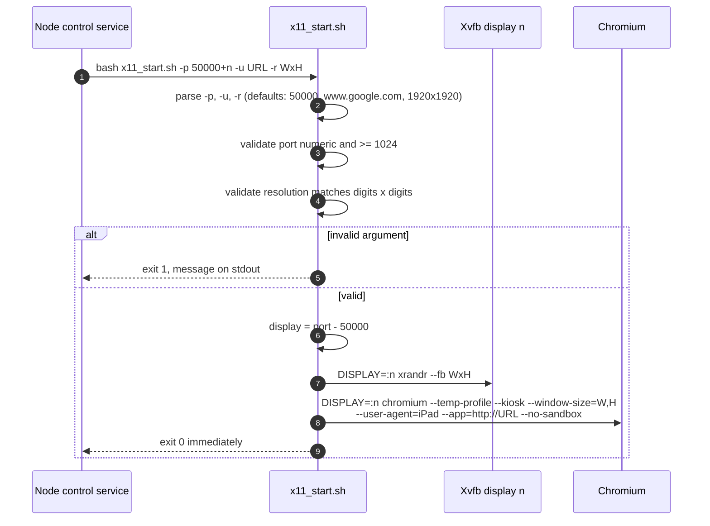

**Key files:**
- `webshare_project/x11_start.sh` — argument parsing, validation, `xrandr`, Chromium launch
- `webshare_project/x11_server/index.js` — builds the command line
- `webshare_project/auto_start.sh` — must have created Xvfb `:n` and x11vnc on `50000+n` beforehand

**Notes:**
- `x11_start.sh` assumes `DISPLAY=:n` already exists. If Xvfb is missing, `xrandr` and Chromium fail, but the script still exits `0` because it does not check either command.
- Chromium is launched with `--app=http://$url`. Supplying a URL that already has a scheme produces `--app=http://https://example.com`; the reference client accepts both forms, so protocol-prefixed URLs start the wrong page.
- `EXTENSION_PATH="~/.config/chromium/Default/Extensions"` is double-quoted, so the tilde is not expanded. The `--load-extension` path is literal and the versioned extension directory is brittle; Chromium logs an error and continues without it.
- `--no-sandbox` is passed unconditionally, which weakens browser isolation.
- There is no readiness signal. Node and Spring have already returned success before Chromium paints anything.
- `xrandr --fb` is backgrounded, so Chromium can start before the framebuffer resize completes.
- The script never checks whether the display is already occupied by an old Chromium from a slot that was freed before `x11_kill.sh` completed.

---

## X11 Slot Kill

Node invokes `x11_kill.sh` when a slot is destroyed; the script finds Chromium processes attached to the slot's display and kills them.

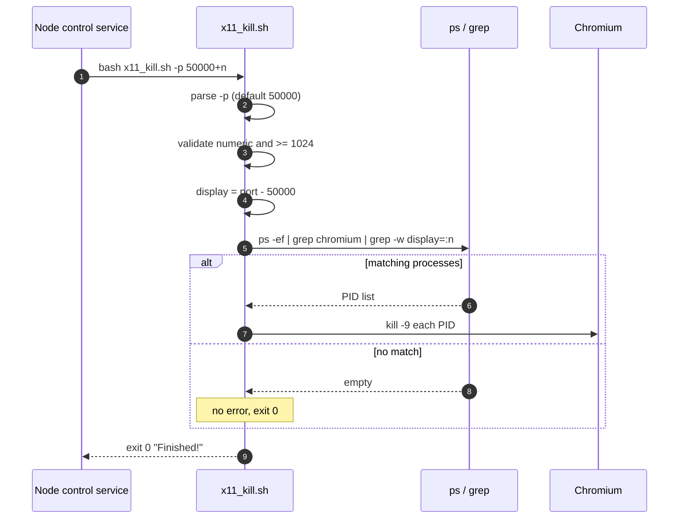

**Key files:**
- `webshare_project/x11_kill.sh` — display derivation and process match
- `webshare_project/x11_server/index.js` — `/kill` route
- `webshare_project/auto_start.sh` — Chromium command line must contain `--display=:n` for the match to work

**Notes:**
- Only Chromium is killed. Xvfb `:n` and x11vnc `50000+n` stay alive; this is intentional so the slot can be reused, but it means a killed slot still accepts VNC connections to an empty/black display.
- The match uses `grep -w "display=:${display}"`, which depends on Chromium's command line retaining `--display=:n`. A different Chromium version or launcher flag can make the kill silently miss.
- `kill -9` is immediate; there is no graceful browser shutdown, no wait, and no verification that the process is gone.
- Missing or invalid `-p` exits `1`; Node ignores it.
- Killing an already-empty display is a success. The caller cannot distinguish "killed" from "nothing there".

---

## X11 Global Clean

`x11_clean.sh` tears down every Xvfb display on the host and removes stale X lock files. It is called by Node's `/clean` route and by `auto_stop.sh`.

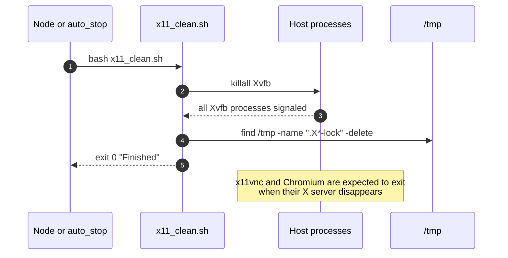

**Key files:**
- `webshare_project/x11_clean.sh` — `killall Xvfb`, lock removal
- `webshare_project/x11_server/index.js` — `/clean` route
- `webshare_project/auto_stop.sh` — calls the script during shutdown

**Notes:**
- This is host-wide and destructive: every channel's display dies, not just one slot.
- It does not kill x11vnc, Chromium, websockify, Node, or Tomcat directly. It relies on the X clients exiting when Xvfb disappears.
- `killall Xvfb` uses the default `SIGTERM`; if a process ignores it, it survives.
- The `find` pattern is `.X*-lock`, which matches `/tmp/.X0-lock` and `/tmp/.X99-lock`. It can delete lock files that belong to a display that was not started by this deployment.
- Node answers `finished!` before the script completes, so a caller cannot use the response as a readiness signal.

---

## Host Auto Start

`auto_start.sh` provisions the entire stack on a Linux host: it stops any previous instance, starts Xvfb, x11vnc, websockify, the Node control service, and Tomcat.

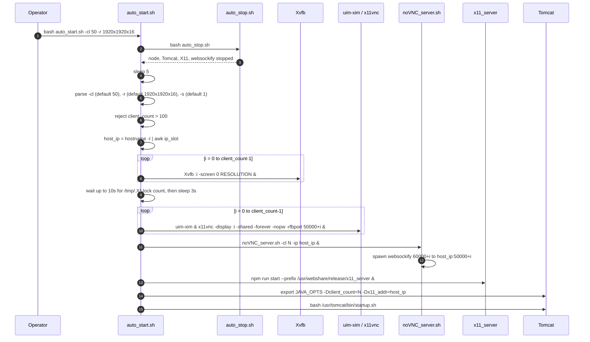

**Key files:**
- `webshare_project/auto_start.sh` — orchestration and argument parsing
- `webshare_project/auto_stop.sh` — unconditional pre-clean
- `webshare_project/noVNC_server.sh` — websockify fleet
- `webshare_project/x11_server/index.js` — control service started via npm
- `webshare_project/auto_start.sh` — x11vnc command line for each slot

**Notes:**
- The first action is `auto_stop.sh`, which kills **all** Node processes on the host and all Xvfb displays. Restarting the stack therefore drops every live session.
- `-Dclient_count` and `-Dx11_addr` are exported into the environment before `startup.sh`. `SlotManager` reads `client_count` when its class is first loaded, so the value must be present before Tomcat starts. Changing the slot count requires a Tomcat restart.
- The script accepts `client_count` up to 100, matching `SlotManager.CLIENT_COUNT = 100`, but `SlotManager` falls back to 100 when the property is absent. Starting Tomcat manually without `-Dclient_count` creates 100 logical slots while `auto_start.sh` created only 50 displays/websockify ports by default; slots 50–99 redirect to ports that do not exist.
- The Xvfb wait loop counts `/tmp/.X*-lock` files and gives up after 10 seconds without checking process health. It then sleeps 3 more seconds unconditionally. If Xvfb cannot start because a display is already in use, the script continues anyway.
- x11vnc is started with `-nopw` and no `-localhost`, so ports `50000+n` are reachable directly without TLS, noVNC, or view-only enforcement.
- `host_ip` is selected with `hostname -I | awk -v slot=... '{print $slot}'`. On a multi-homed host the chosen address may not be the address clients use or the address reachable from the host itself. `noVNC_server.sh` rejects an empty or non-IPv4 value and exits, but `auto_start.sh` continues to start Node and Tomcat.
- There are no readiness checks between noVNC, Node, and Tomcat. Tomcat can accept requests before the control service is listening.
- Most services are backgrounded (`&`); their failures are not collected and do not stop the script.

---

## Host Auto Stop

`auto_stop.sh` performs a hard shutdown of every component started by `auto_start.sh`.

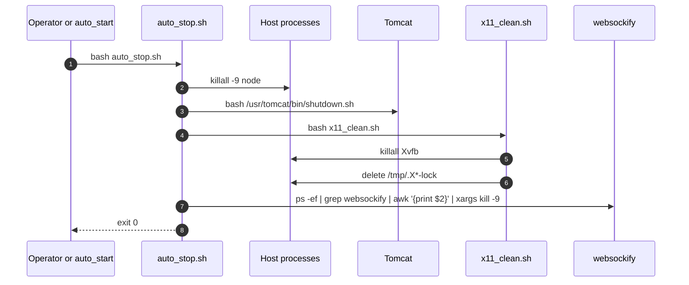

**Key files:**
- `webshare_project/auto_stop.sh` — shutdown sequence
- `webshare_project/x11_clean.sh` — display cleanup
- `/usr/tomcat/bin/shutdown.sh` — external Tomcat script (not in repo)

**Notes:**
- `killall -9 node` kills every Node process owned by the host, not only `x11_server`. Any unrelated Node application on the machine is terminated.
- Tomcat shutdown is asynchronous; the script does not wait for it. A following `auto_start.sh` only sleeps 5 seconds before continuing.
- All slot state is in memory. Stopping Tomcat discards the free/using maps, and the host processes are also torn down, so the next start is intended to begin from a clean state.
- The websockify teardown uses a `ps | grep | awk | xargs kill -9` pipeline. It can match unrelated processes whose command line contains "websockify" and can pass an empty list to `xargs` (which is tolerated on GNU xargs).
- There is no graceful drain, no notification to connected browsers, and no preservation of session state.

---

## noVNC Server Provisioning

`noVNC_server.sh` starts one websockify process per slot. Each process serves the vendored noVNC client over TLS and proxies the `/websockify` WebSocket to the matching x11vnc port.

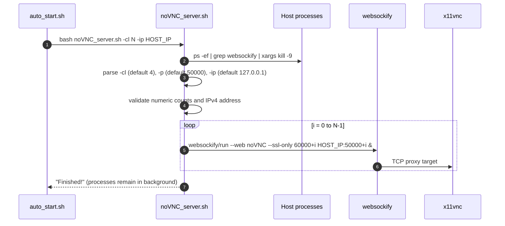

**Key files:**
- `webshare_project/noVNC_server.sh` — fleet launcher and argument validation
- `webshare_project/noVNC/` — static client served by `--web`
- `webshare_project/noVNC/websockify/run` — **not present in this checkout**; expected in the deployment bundle
- `webshare_project/auto_start.sh` — caller

**Notes:**
- The script kills all existing websockify processes **before** validating its own arguments. A bad invocation leaves the host with no noVNC service.
- `--ssl-only` means websockify accepts TLS WebSocket connections only. noVNC decides between `ws` and `wss` from the page protocol, so the page must be loaded over HTTPS for the connection to succeed.
- No certificate or key path is passed to websockify. TLS behavior depends on the deployed websockify `run` wrapper and its default certificate. A missing or untrusted certificate shows a browser warning and can block `wss`.
- The repository does not vendor `websockify/run`, so in a plain checkout every loop iteration fails to start a process. The script still prints `Finished!` and exits `0`.
- Each websockify is an unsupervised background process. If one dies, its slot's noVNC page is unreachable while `SlotManager` still considers the slot usable.
- The target address is `HOST_IP:50000+i`, not `127.0.0.1`. websockify connects back to the host through the public/selected interface; a NAT address or firewall can break the proxy even though both processes are on the same machine.

---

## Browser Client Connect

The reference client in `test_client/` validates input, asks `/status` whether it may connect, and then loads the appropriate `/connect/...` URL into an iframe. The iframe follows Spring's redirect to the slot's noVNC page.

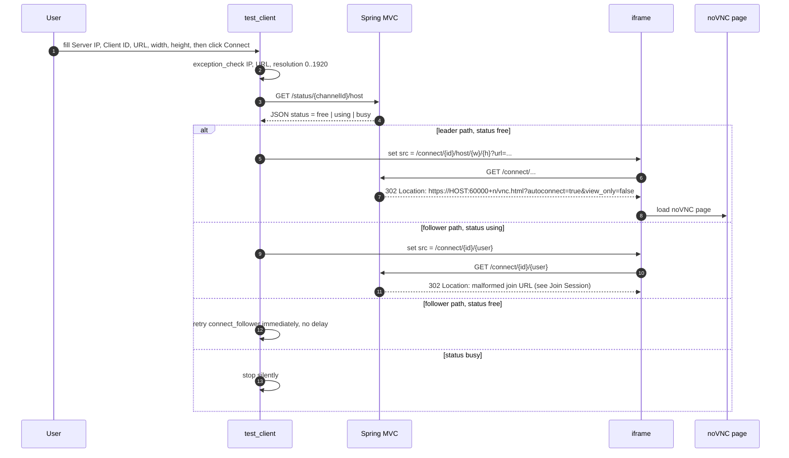

**Key files:**
- `test_client/index.html` — leader form, iframe
- `test_client/script.js` — reads form values, constructs `web_share`, calls `connect_leader`
- `test_client/web_share.js` — `status`, `connect_leader`, `connect_follower`, `disconnect`, `clear`, validation
- `test_client/webshare.js` — an unused duplicate of the same client class
- `test_client/script_api.js` — stale harness written against an older `web_share` API; it passes the iframe where `user_type` is expected, and its parameterless calls fail validation

**Notes:**
- `SERVER_PORT` is hard-coded to `8443` and the base URL is hard-coded to `https://IP:8443/webshare`. The input form's `port` field is read but never used.
- Sample endpoints are hard-coded: `221.139.104.115` in `index.html` and `192.168.0.211` in `script_api.js`. These are demo values, not configuration.
- The leader path checks `status === "free"` once and then creates. Two leaders can both pass the check and race; Spring's create path is not idempotent under concurrency.
- The follower path requires `status === "using"`. If the status is `free`, it retries recursively with no delay, producing a tight request loop until a leader creates the session. If the status is `busy`, it gives up silently.
- `index.html` always passes `host`, so the visible test client only exercises the control path. The follower path is exposed by the class but not wired to a working form.
- Initially, `connect_leader` and `connect_follower` return `true` synchronously, before the `/status` promise resolves. The UI disables the Connect button even when the status check later fails and no session is created.
- The iframe navigation means `/disconnect` and `/clear` render `result.jsp` inside the browser frame. Refreshing that frame repeats the GET and therefore repeats the side effect.
- Validation is entirely client-side: IP regex, URL regex, and resolution between 0 and 1920. The server validates none of these.

---

## noVNC Screen Stream

After the redirect, the browser runs the vendored noVNC client. It auto-connects over WSS to websockify, which proxies the VNC protocol to x11vnc, which reads the Xvfb framebuffer where Chromium is rendering.

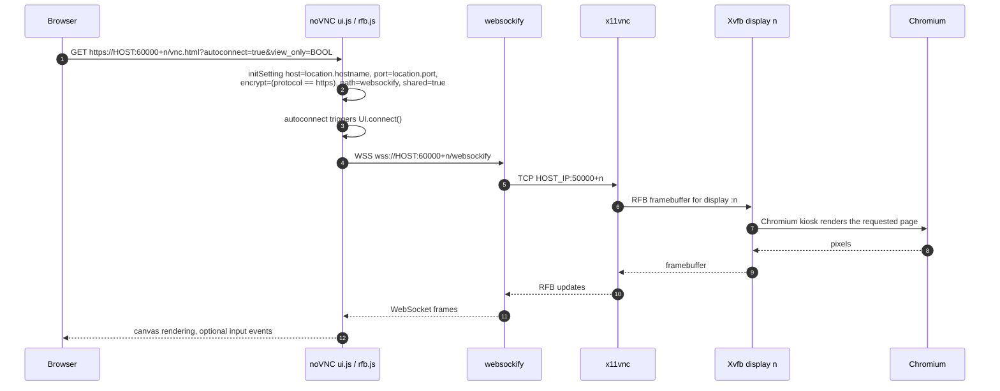

**Key files:**
- `webshare_project/noVNC/vnc.html` — client shell
- `webshare_project/noVNC/app/ui.js` — settings from query string, autoconnect, control bar, `view_only`
- `webshare_project/noVNC/core/rfb.js` — RFB protocol and input gating
- `webshare_project/noVNC/app/webutil.js` — `getConfigVar` reads hash first, then query string
- `webshare_project/noVNC_server.sh` — websockify TLS endpoint
- `webshare_project/auto_start.sh` — x11vnc command line

**Notes:**
- `view_only` is enforced only in the browser (`rfb.js` skips pointer and keyboard events, `ui.js` hides the control bar). x11vnc is started with `-nopw` and accepts any VNC client, so a user who connects directly to `50000+n`, or edits the noVNC page to clear the query flag, gets full control.
- The VNC server is `-shared -forever -nopw`: multiple clients see the same screen, there is no VNC password, and the session survives client disconnects.
- noVNC derives the WebSocket port from `window.location.port`, which is why Spring must redirect to `60000+n`. If the page is opened through a proxy on another port, the default connection targets the wrong port.
- `encrypt` is derived from the page protocol. Loading noVNC over HTTP produces `ws://`, but websockify is `--ssl-only`, so the handshake fails.
- If websockify is missing, the browser shows a connection failure. If x11vnc or Xvfb is missing, websockify accepts the WebSocket but the TCP proxy fails. If Chromium is missing, the user sees a blank desktop. Spring has no health check for any of these conditions.
- The vendored noVNC is version 1.2.0 (MPL-2.0). Its `ui.js` contains local modifications, including Korean comments and custom `view_only` handling.

---

## Slot Lifecycle Reference

Slot state is not a separate persisted model; it is the union of the `free_slot` queue and the `using_slot` map in `SlotManager`. `SlotManager` and `RequsetManager` are process-wide singletons created through `getInstance()`, not Spring beans; `WebShareService` is the `@Service` that owns them, so slot state survives individual requests but not a Tomcat restart.

| Current state | Trigger | Next state | Side effects |
|---------------|---------|------------|--------------|
| Free (in queue) | `createSession` takes slot `n` | Using | Side-effecting GET to Node `/create`, Chromium starts on `:n`, map entry created, count 1 |
| Using | `enterSession` | Using | Count incremented; no new Chromium |
| Using | `leaveSession` with count > 1 | Using | Count decremented |
| Using | `leaveSession` with count reaching 0 | Free | Node `/kill`, Chromium killed, map entry removed, slot returned to queue |
| Using | `clearSession` | Free | Node `/kill`, Chromium killed, map entry removed, slot returned to queue regardless of count |
| Using | Node `/create` failed or was unreachable | Using | No Chromium, but slot is still marked used and count is incremented |
| Free | `getFreeSlot` race after `peek` | Free | Caller may block in `take()` until a slot is returned |

---

## Failure Paths and Edge Cases

| Failure | Trigger | Where | Effect |
|---------|---------|-------|--------|
| No free slot | New channel, queue empty | `SlotManager.getFreeSlot` → `WebShareService.createSession` | Returns the literal string `NO URL BECAUSE OF ERROR`; controller redirects to it. No error page and no HTTP error status. |
| Free-slot race | Queue empties between `peek()` and `take()` | `SlotManager.getFreeSlot` | `take()` blocks the request thread indefinitely; there is no timeout or fallback. |
| Unknown channel, join | `/connect/{id}/{user}` with no slot | `WebShareService.enterSession` | Error-string redirect; no slot is allocated. |
| Missing `url` parameter | `/connect/{id}/{user}/{w}/{h}` without `?url=` | `UserController.createSession` (`@RequestParam` required) | Spring returns `400 Bad Request` before the handler; no slot is allocated. |
| Unknown channel, disconnect/clear | `/disconnect` or `/clear` with no slot | `WebShareService.leaveSession` / `clearSession` | Logs an error, returns normally, renders `success!`. Caller cannot tell nothing happened. |
| Node unreachable | Control service down, wrong `x11_addr`, firewall | `RequsetManager.request` | `URLConnection` throws; stack trace is printed and swallowed. There are no connect or read timeouts, so a blackholed service can hang the request thread. The slot has already been taken from the free queue, and it is still marked used when the call returns; the user is redirected to noVNC regardless. The same lack of timeouts applies to `/kill` during disconnect and clear. |
| Node returns early | Every `/create` | `shelljs` async + immediate `res.send` | User arrives before Chromium is ready; no retry or readiness check. |
| Shell rejects arguments | Bad width/height/port/URL | `x11_start.sh` | Script exits `1`; Node already answered `200`; slot is consumed with no browser. |
| Missing websockify | Plain checkout or incomplete deployment | `noVNC_server.sh` | `noVNC/websockify/run` not found; every slot has no HTTPS listener; script still reports success. |
| TLS/certificate failure | `--ssl-only` with no usable certificate | websockify | WSS handshake fails; noVNC reports "Failed to connect to server". |
| HTTP instead of HTTPS | Spring accessed over HTTP | `WebShareService` URL builder | noVNC page uses `ws://` against a TLS-only port; connection fails. |
| Hard-coded client endpoints | Sample IPs and port `8443` | `test_client/index.html`, `web_share.js`, `script_api.js` | Only works against the original host/port/context; any deployment change requires editing the client. |
| Proxy or host rewrite | Public host differs from request host | `convertHostUrl` | Uses the request URL's scheme and host, drops its port and path, and ignores `X-Forwarded-*`. IPv6 literals also break the colon split. Redirect can point at the wrong host. |
| Malformed join URL | Every `/connect/{id}/{user}` | `WebShareService.enterSession` | Duplicated `://` and boolean in port position; followers cannot reach noVNC through the redirect. |
| Slot-count mismatch | Tomcat started without or with a different `-Dclient_count` | `SlotManager` constructor | Default 100 while the default host setup creates 50 displays; slots 50–99 map to nonexistent ports. A value above 100 or a non-numeric value aborts `SlotManager` class initialization (`ExceptionInInitializerError`), preventing startup. |
| Create race | Two first requests for the same channel | `WebShareService.createSession` | Two slots and two Chromium processes; one map entry overwrites the other; one slot leaks permanently. |
| Refcount race | Duplicate or concurrent disconnect, or disconnect racing clear | `UsingInfo` / `leaveSession` / `clearSession` | One viewer can destroy a shared session; concurrent decrements can kill twice and return the same slot to the queue twice, assigning one display to two channels. |
| Refcount leak | Closed tab, page reload, no disconnect call | client + `UsingInfo` | Count stays above zero; slot remains `using` forever. No timeout or reaper exists. |
| No identity tracking | Any `user` value | All Spring endpoints | `user` only selects `view_only`. Anyone who knows a channel id can join, disconnect, or clear it. |
| Unescaped start URL | URL contains `&`, `;`, spaces, shell syntax | `RequsetManager` query + Node shell string | Truncated query parameters or arbitrary command execution on the host as the Node user. |
| Direct VNC access | Port `50000+n` reachable | `auto_start.sh` (`x11vnc -nopw`, no `-localhost`) | Unauthenticated, unencrypted VNC access that bypasses noVNC and `view_only`. |
| View-only bypass | Modified client or direct VNC | `noVNC/app/ui.js`, `noVNC/core/rfb.js` | `view_only` is client-side only; the server does not enforce read-only sessions. |
| Global `/clean` | Node `/clean` or `auto_stop.sh` | `x11_clean.sh` | Kills every Xvfb display on the host; all channels drop simultaneously. |
| Destructive stop | `auto_stop.sh` or `auto_start.sh` | `auto_stop.sh` | `killall -9 node` terminates unrelated Node applications; Tomcat shutdown is not awaited. |
| websockify kill pattern | `noVNC_server.sh` or `auto_stop.sh` | `ps \| grep \| awk \| xargs kill -9` | Any process with "websockify" in its command line can be killed; empty input is passed to `xargs`. |
| No cleanup job | Always | none | There is no scheduled reaper, heartbeat, or TTL for stale slots or dead browser processes. |

---

## Coverage Notes

- **All HTTP endpoints are covered:** `GET /`, the two `/connect` forms, `/disconnect`, `/clear`, and `/status` on the Spring side; `/create`, `/kill`, and `/clean` on the Node side.
- **All process scripts are covered:** `auto_start.sh`, `auto_stop.sh`, `noVNC_server.sh`, `x11_start.sh`, `x11_kill.sh`, `x11_clean.sh`.
- **All client paths are covered:** leader/follower status checks, iframe navigation, redirect to noVNC, WSS/websockify/x11vnc/Xvfb/Chromium streaming.
- **Not present in this repository:** authentication, registration, login, session tokens, token refresh, password reset, OAuth callbacks, database reads/writes, ORM models, file uploads, job queues, cron jobs, event emitters, inbound/outbound webhooks, and cache integrations. Their absence is intentional and matches the deployment model.
- **Not verified by tests:** the repository has no automated test suite and no CI. Every behavior above is read from source, not exercised against a running Linux host.
