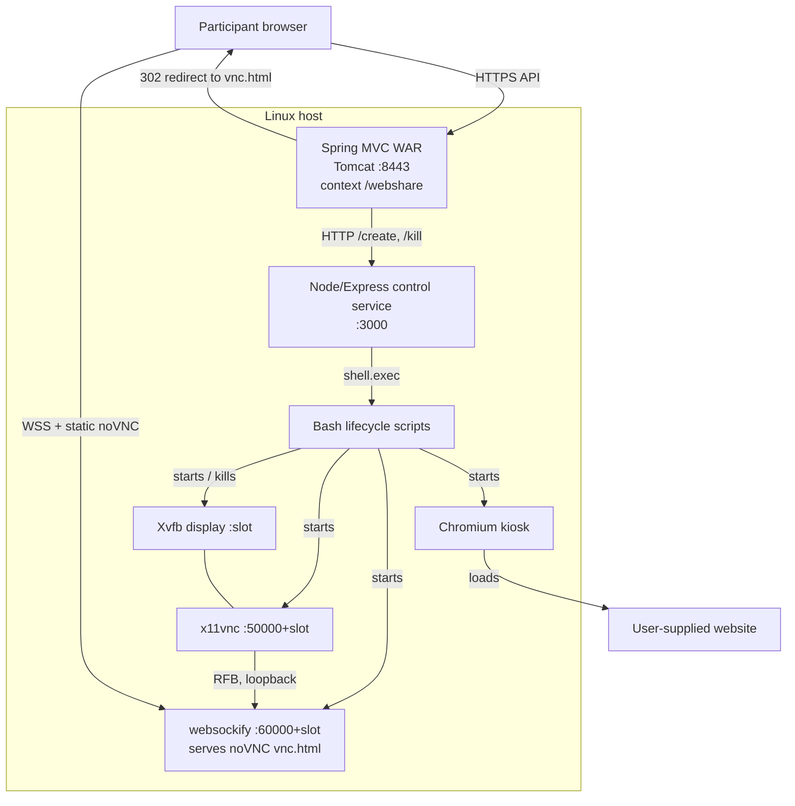

# WebShare — Overview

> Generated from a static read of the repository on 2026-11-09. No build,
> deployment, or runtime verification was performed. Commands below come from
> the checked-in POM, scripts, and configuration.

**In one sentence:** WebShare gives each channel a private Chromium session on a
shared Linux host and streams it to participants as a noVNC web page.

## What Is This?

WebShare is a self-hosted browser-sharing service. A caller opens a *channel*
through a Spring MVC HTTP API, supplying an initial URL and viewport size. The
backend allocates a numbered slot, asks a small Node/Express service to launch
Chromium on the matching Xvfb display, and redirects every participant to a
per-slot noVNC page. The `host` user gets keyboard and mouse control; other
users join the same channel as view-only spectators.

It solves the "let several people watch or drive one browser" problem without
asking participants to install a VNC client: the shared browser runs on a Linux
host, and each participant only needs a modern browser that can open a
WebSocket. A process-wide `SlotManager` multiplexes up to 100 slots and keeps a
slot alive until its last user disconnects (or the channel is explicitly
cleared).

This is not a monorepo and has no React, Next.js, RSC, npm workspace, or
frontend build step. It is three cooperating runtimes plus a static test
harness: a Java WAR, a Node control service, and a set of Bash scripts that
manage X11, VNC, websockify, and Chromium.

## Tech Stack

| Layer | Technology | Notes |
|-------|------------|-------|
| Languages | Java, JavaScript (Node and browser), Bash, HTML/CSS | Java compiler pins source/target `1.6`; the `java-version` property says `1.7` but is not wired into `maven-compiler-plugin`. No TypeScript. |
| Backend framework | Spring MVC `4.3.1.RELEASE`; Express `4.17.1` | Spring runs as a WAR on Servlet 2.5 / JSP 2.1. Node uses CommonJS and `shelljs`. |
| Frontend | JSP/JSTL views; vanilla HTML/CSS/JS; vendored noVNC `1.2.0` | No React/Next/RSC, no bundler, no npm workspace. The noVNC core is MPL-2.0. |
| Database | None | All free/used slot state lives in memory in `SlotManager`. |
| Auth | None | No Spring Security or login. Controllers use `@CrossOrigin(origins = "*")`; x11vnc is started with `-nopw`. TLS only protects the Spring and websockify hops. |
| Testing | JUnit `4.7` declared; zero test classes; noVNC's upstream Karma tests are vendored | `mvn test` has nothing to run; `npm test` is a stub that exits 1. No CI for WebShare. |
| Deployment | Tomcat WAR plus Linux host scripts | Tomcat at `/usr/tomcat`; bundle at `/usr/webshare/release`; WAR must be deployed as `webshare.war` for the `/webshare` context path. |
| Key libraries | Jackson `2.9.4`, SLF4J `1.6.6`, Log4j `1.2.15`, AspectJ `1.6.10`, JSTL `1.2`, shelljs `0.8.4` | Runtime dependencies are Xvfb, x11vnc, Chromium, websockify, and noVNC. |

No Node `engines` field is declared. The scan environment had Node `v22.22.3`
and Maven `3.9.16`; those are not pinned by the project.

## System Context



No database, message queue, cache, CDN, or cloud API is configured. The only
outbound dependency is the website Chromium loads on behalf of the user.

### Session flow

```mermaid
sequenceDiagram
    autonumber
    participant B as Participant browser
    participant S as Spring /webshare
    participant SM as SlotManager
    participant N as Node :3000
    participant H as Linux X11 host

    B->>S: GET /connect/channel/user/w/h?url=...
    S->>SM: getUsingSlot(channel)
    alt no existing slot
        SM-->>S: free slot n
        S->>N: GET /create?port=50000+n&url=...&width=...&height=...
        N->>H: bash x11_start.sh -p 50000+n -u ... -r WxH
        H->>H: xrandr --fb WxH; chromium --kiosk --app=...
    else existing slot
        SM-->>S: UsingInfo(n)
    end
    S-->>B: 302 https://host:60000+n/vnc.html?autoconnect=true&view_only=...
    B->>H: WSS :60000+n -> websockify -> x11vnc :50000+n
```

The Node `/create` call is fire-and-forget: `index.js` starts the shell command
asynchronously and immediately replies `finished!`. Spring redirects to
`vnc.html` without waiting for Chromium to be ready. In the create path, for the
`host` user `view_only=false`; for every other user `view_only=true`.

## Entry Points

| Entry | Path | Purpose |
|-------|------|---------|
| Web app descriptor | `webshare_spring/webshare/src/main/webapp/WEB-INF/web.xml` | Registers the Spring root context and maps `DispatcherServlet` to `/`. |
| Spring MVC config | `webshare_spring/webshare/src/main/webapp/WEB-INF/spring/appServlet/servlet-context.xml` | Enables annotations, component-scans `com.webshare.service` and `com.webshare.controller`, resolves JSPs from `/WEB-INF/views/`. |
| Public HTTP API | `webshare_spring/webshare/src/main/java/com/webshare/controller/UserController.java` | `/connect/...`, `/disconnect/...`, `/clear/...`, `/status/...`. |
| Home page | `webshare_spring/webshare/src/main/java/com/webshare/controller/HomeController.java` | `GET /` renders `home.jsp`. |
| Slot allocation | `webshare_spring/webshare/src/main/java/com/webshare/util/SlotManager.java` | Process-wide singleton with a blocking queue of free slots and a map of channel to `UsingInfo`; statuses are `free`, `using`, `busy`. |
| Session orchestration | `webshare_spring/webshare/src/main/java/com/webshare/service/WebShareService.java` | Creates, joins, leaves, and clears sessions; builds the noVNC URL. |
| Node control API | `webshare_project/x11_server/index.js` | Express server on `:3000` with `/create`, `/kill`, `/clean`; shells out to the X11 scripts. |
| Full-stack start | `webshare_project/auto_start.sh` | Stops the old stack, starts Xvfb per slot, uim, x11vnc, websockify, Node, then Tomcat. |
| Full-stack stop | `webshare_project/auto_stop.sh` | Kills all Node processes, Tomcat, all Xvfb, and websockify. |
| Per-slot browser start | `webshare_project/x11_start.sh` | Resizes the display with `xrandr`, launches Chromium in kiosk mode. |
| Per-slot browser kill | `webshare_project/x11_kill.sh` | Kills the Chromium process for one display. |
| Global X11 clean | `webshare_project/x11_clean.sh` | `killall Xvfb` and deletes `/tmp/.X*-lock`. |
| noVNC gateway | `webshare_project/noVNC_server.sh` | Starts one websockify per slot with `--ssl-only`, serving the noVNC directory. |
| noVNC client | `webshare_project/noVNC/vnc.html` | Per-slot UI; its document title is customized to `webshare`. |
| Manual test UI | `test_client/index.html` | Host connect/disconnect harness using an iframe. |
| API test UI | `test_client/index_api.html` | Older API harness; see gaps below. |
| Load test UI | `test_client/index_performance.html` | Opens many iframes against many channels. |

There is no root `README.md`, `Makefile`, `Dockerfile`, or CI workflow. The only
README and CI files in the tree belong to the vendored noVNC 1.2.0 project.

## Key Configuration

### Ports

| Port | Owner | Purpose |
|------|-------|---------|
| `8443` | Tomcat / Spring | HTTPS API and redirects; public client assumes this port. |
| `8080` | Tomcat | Plain HTTP connector, configured with `redirectPort="8443"`. |
| `8009` | Tomcat | AJP connector, also configured with `redirectPort="8443"`. |
| `3000` | Node/Express | Internal control API; called by Spring over plain HTTP. |
| `50000 + slot` | x11vnc | VNC server for the slot's Xvfb display. |
| `60000 + slot` | websockify | WSS endpoint and static noVNC files for the slot. |
| `:0` … `:N-1` | Xvfb | One X display per slot; display number equals slot number. |

Slot `n` maps to `Xvfb :n`, `x11vnc :50000+n`, `websockify :60000+n`, and
`https://host:60000+n/vnc.html`.

### JVM system properties

- `client_count` — number of slots. `SlotManager` falls back to `100` when the
  property is absent; `auto_start.sh` defaults to `50` and rejects values above
  `100`. The free-slot queue is sized at a fixed `100`.
- `x11_addr` — host address of the Node control service. `WebShareService`
  reads `-Dx11_addr`; if missing, it falls back to
  `InetAddress.getLocalHost().getHostAddress()`.

`auto_start.sh` exports both through `JAVA_OPTS` before calling
`/usr/tomcat/bin/startup.sh`.

### Hard-coded values

- Spring: `WebShareService.NOVNC_PORT = 60000`;
  `RequsetManager.PORT = 3000`; `RequsetManager.X11PORT = 50000`.
- Node: `PORT = 3000`, `X11_PORT = 50000`,
  `webshare_dir = '/usr/webshare/release'`.
- noVNC script: `novnc_dir = '/usr/webshare/release/noVNC'`,
  `x11_port = 50000`, `noVNC_port = 60000`.
- Defaults: `auto_start.sh` uses 50 slots at `1920x1920x16`;
  `x11_start.sh` uses `1920x1920` and `www.google.com`;
  `noVNC_server.sh` uses 4 clients on `127.0.0.1`.
- Tomcat reference config: `keystoreFile =
  /usr/webshare/release/SSL/genes.keystore` on the 8443 connector. The file
  uses a `CHANGE_ME` keystore-password placeholder; see the security notes.

### Script flags

| Script | Flags |
|--------|-------|
| `auto_start.sh` | `-cl` / `--client` (slot count), `-r` / `--resolution`, `-s` / `--ipSlot` (which address from `hostname -I` to use). |
| `noVNC_server.sh` | `-cl` / `--client`, `-p` / `--port` (x11vnc base port), `-ip` / `--ip`. |
| `x11_start.sh` | `-p` / `--port`, `-u` / `--url`, `-r` / `--resolution`; it also parses `-c` / `--connect` and `-i` / `--internet`, but those values are unused. |
| `x11_kill.sh` | `-p` / `--port`. |

### Environment variables

The Java and Node application code read no environment variables. The boot path
sets `JAVA_OPTS`, per-process `DISPLAY`, and the uim input-method variables
`GTK_IM_MODULE`, `QT_IM_MODULE`, and `XMODIFIERS` (to `uim` / `@im=uim`).
There is no `.env`, `application.yml`, `application.properties`, or external
configuration service in the repository.

## How to Run

### Prerequisites

A Linux host with `Xvfb`, `x11vnc`, `chromium`, `uim`, `websockify`, Node/npm,
a JDK, Maven, and Tomcat. The scripts use Linux-only tools such as
`hostname -I`, `killall`, `ps -ef`, and absolute `/usr/...` paths; they will not
run as-is on macOS.

`websockify` is not vendored in this checkout. `noVNC_server.sh` expects an
executable at `noVNC/websockify/run`.

### Build the WAR

```bash
cd webshare_spring/webshare
mvn clean package
# -> target/controller-1.0.0-BUILD-SNAPSHOT.war
```

Deploy the WAR as `webshare.war` so Tomcat serves the `/webshare` context path.
The compiler is pinned to Java 1.6; the JDK 26 installed in this environment
will not compile that source level unmodified. Use an older JDK or raise the
compiler `source`/`target` values.

### Expected deployment layout

```text
/usr/webshare/release/
├── auto_start.sh, auto_stop.sh
├── noVNC_server.sh, x11_start.sh, x11_kill.sh, x11_clean.sh
├── x11_server/              Node control service
├── noVNC/                   vendored noVNC; websockify/ expected here
└── SSL/genes.keystore       referenced by tomcat_need/server.xml
/usr/tomcat/                 Tomcat with webapps/webshare.war
```

### Start and stop the full stack

```bash
# Copy the contents of webshare_project/ to /usr/webshare/release first.
bash /usr/webshare/release/auto_start.sh -cl 50 -r 1920x1920x16

# Stop everything.
bash /usr/webshare/release/auto_stop.sh
```

`auto_start.sh` begins by calling `auto_stop.sh`, which runs `killall -9 node`,
Tomcat's shutdown script, `killall Xvfb`, and a websockify kill. Treat both
scripts as whole-host operations.

### Run only the Node service

```bash
cd webshare_project/x11_server
npm install
npm start   # listens on :3000
```

This works as a process, but its handlers still invoke
`/usr/webshare/release/x11_start.sh` and friends, so on a development machine
you must either create that path or edit `webshare_dir` in `index.js`.

### Run only the noVNC gateway

```bash
bash webshare_project/noVNC_server.sh -cl 4 -ip 127.0.0.1
```

It starts one websockify per slot and expects `noVNC/websockify/run` under its
absolute `novnc_dir` (`/usr/webshare/release/noVNC`; repo path
`webshare_project/noVNC/websockify/run`). The script uses that absolute path
regardless of where it is invoked, so deploy the bundle first (or edit
`novnc_dir`).

### Manual test client

Open `test_client/index.html` in a browser. It points at a sample endpoint
(`221.139.104.115:8443`) and lets you enter a server IP, channel ID, URL, width,
and height. `index_api.html` uses `192.168.0.211`; `index_performance.html`
opens many iframes at once. These IPs are sample endpoints, not configuration.

### Tests

There are no WebShare tests to run. `src/test` contains only
`resources/log4j.xml`, so Maven has zero test classes to execute (assuming the
build itself succeeds). `npm test` is
`echo "Error: no test specified" && exit 1`. The noVNC tree contains upstream
Karma tests, but they are not wired into this project's build or CI.

## Known Gaps and Rough Edges

### Project infrastructure

- No root `README.md`; `AGENTS.md` and `docs/agents/*` are the only project
  documentation. The only README files are inside vendored noVNC.
- No CI/CD configuration for WebShare. The `.github/workflows/` files under
  `webshare_project/noVNC/` belong to upstream noVNC.
- No automated tests for the Java or Node code. JUnit 4.7 is declared but
  unused; `npm test` is a failing stub.
- The repository has no commits yet (`git log` reports no commits on `main`),
  and every top-level file is untracked. Treat this checkout as an initial
  snapshot rather than a history you can bisect.
- No Dockerfile, root Makefile, or other reproducible build entry point for
  WebShare.

### Missing runtime pieces

- `webshare_project/noVNC/websockify/` does not exist, but
  `noVNC_server.sh` invokes `${novnc_dir}/websockify/run` for every slot.
  Startup will fail unless websockify is installed there separately. Upstream
  `noVNC/utils/launch.sh` can clone it, but `noVNC_server.sh` does not use that
  launcher.
- `noVNC_server.sh` passes `--ssl-only` without `--cert`. websockify defaults
  to `self.pem`, and no `self.pem` is present in the noVNC tree. A certificate
  and key must be supplied or placed in websockify's working directory.
- The deployment paths are absolute and hard-coded to `/usr/webshare/release`
  and `/usr/tomcat`; there is no environment-variable override.

### Behavioral notes

- The join-existing-session path is broken as written:
  `WebShareService.enterSession()` builds
  `"://%s:%s/vnc.html?autoconnect=true&view_only=%b"` but passes only two
  arguments (`port`, `isControl`). `String.format` will throw
  `MissingFormatArgumentException`. The literal also adds a second `://` before
  the port. This affects `GET /connect/{channelId}/{user}`, the route used by
  followers joining an existing channel.
- `x11_start.sh` always launches Chromium with `--app=http://$url`. Passing a
  URL that already includes `https://` produces `http://https://...`; callers
  should pass a bare host or path.
- `x11_kill.sh` only kills Chromium for the display. x11vnc and websockify are
  not stopped per slot; global cleanup is handled by `auto_stop.sh` and
  `x11_clean.sh`.
- `createSession` only waits for Node's immediate `finished!` reply; it does not
  wait for Chromium to start. There is no readiness handshake before the
  redirect, so a slow Chromium start can produce a first-load connection error.
- `UsingInfo.userCount` is a plain `int` incremented and decremented without
  synchronization; concurrent joins or leaves for the same channel can lose
  updates.
- `UserController` computes `isControl` as
  `userType.equals("host") ? false : true`, which is inverted relative to its
  name; the value is passed to `view_only=%b`. The behavior is correct for
  `host` versus guest, but the variable reads backwards.
- `test_client/index_api.html` is stale: its script constructs `web_share` with
  five arguments while the class takes three, then calls `connect_leader()`
  without a screen or URL. `test_client/webshare.js` is an unused duplicate of
  `web_share.js`; no HTML page loads it. `test_client/index.html` also accepts a
  port field, but `web_share.js` hard-codes `SERVER_PORT = 8443`, so the field is
  ignored.
- `home.jsp` still contains demo `<iframe>` and `<embed>` tags pointing at
  `twosonsoft.com` and `naver.com`; these are leftovers, not part of the
  service flow.

### Security and operations

- There is no authentication or authorization. Both controllers allow any
  origin, and anyone who can reach `:8443` can create, join, clear, or inspect
  channels.
- x11vnc is started with `-nopw` and without `-localhost` (`auto_start.sh`), so
  the `50000+slot` range is unauthenticated and may be reachable from the
  network. Firewall that range and expose only websockify.
- The Node service interpolates `url`, `width`, and `height` from query
  parameters into a `bash` command without escaping (`index.js`), and
  `RequsetManager` does not URL-encode the `url` value. This is a
  command-injection risk; keep `:3000` private and treat the API as
  trusted-network-only.
- `tomcat_need/server.xml` uses a `CHANGE_ME` keystore-password placeholder.
  Supply the real password at deploy time and keep it in a secret store; never
  commit it.
- `ssl_cert/` holds certificate chains and a private key;
  `webshare_project/SSL/` holds a key, certificate, and keystore. Both are
  git-ignored, but they are present in this working tree. Do not commit them or
  print their contents.
